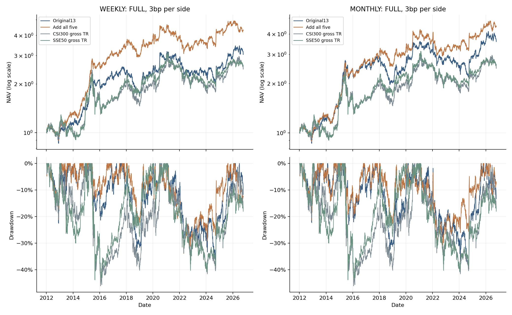
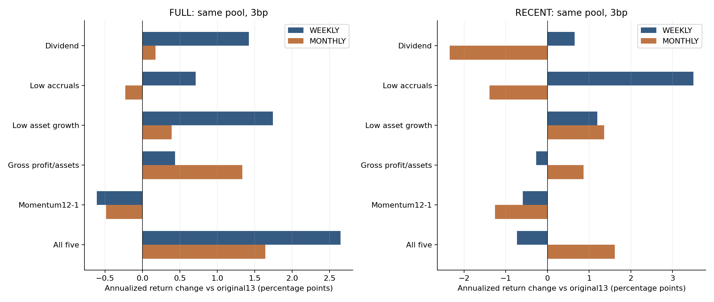
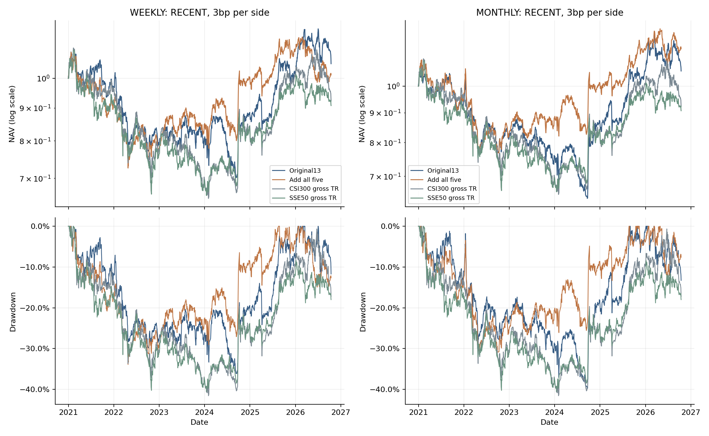
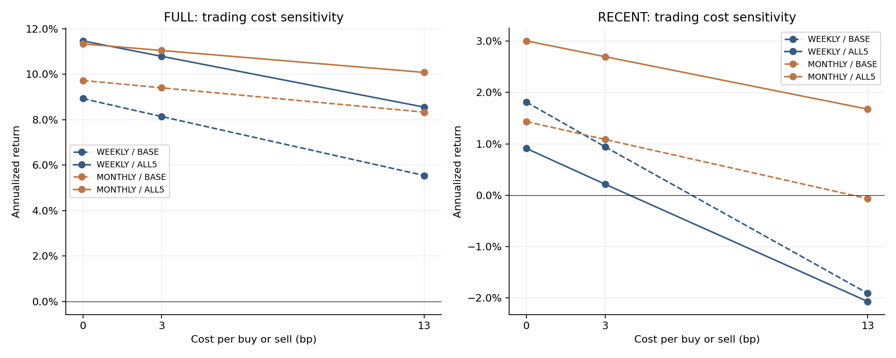
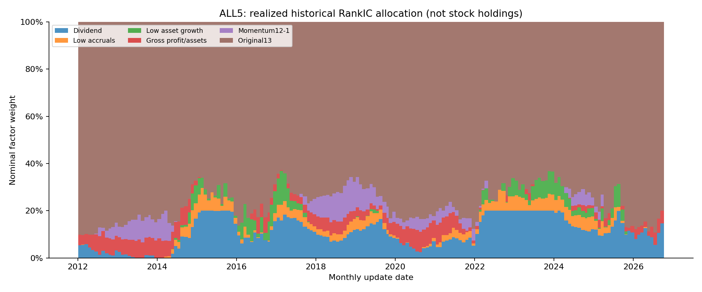

# 给15只多因子组合增加五个因子：股息、利润兑现、资产效率与长期动量的历史验证

研究日期：2026-10-22。回测范围：2012-01-06—2026-10-15；首次模拟成交：2012-01-09收盘。状态：代码、54组回放与独立校验完成；未更改六策略前向纸面账户。

## 一、背景：原方案并非毫无价值，但还没有解决所有问题

前面的研究已经得到两类不能混淆的结论。

一方面，固定15只组合通过分散、持仓缓冲和仓位管理降低了风险。在较低成本下，它也跑赢了本次对照的沪深300和上证50全收益指数。这是实际得到的历史结果，不能因为仍有不足，就把它说成“什么都没解决”。这里的上证50并不是上证综指，不能混用名称。

另一方面，近年的绝对收益偏弱，换手带来的损耗仍然明显；整体RankIC为正，也没有保证最终15只股票持续优于自身股票池。因此，下一步不是不断添加交易开关，而是检查：**原有因子是否缺少一些真正有用的信息？新增信息能不能通过同一套组合规则，转化为扣费后的收益？**

我们此前列出六个候选，其中Beta已经单独研究。本轮不重复加入Beta，只测试其余五个：股息率、应计利润率、总资产增长率、总资产毛利率，以及跳过最近一个月的中长期动量。

## 二、这五个因子分别看什么

| 新增因子 | 本轮计算口径与方向 | 与已有信息的区别 |
| --- | --- | --- |
| 股息率 | Tushare历史`dv_ttm÷100`，数值较高得分较高 | 公司已经实施派现的历史信息，不是承诺将来分红 |
| 低应计利润率 | `－（年度合并净利润－同年度经营现金流净额）÷平均总资产` | 比较账面利润与现金兑现，并按资产规模缩放；不是当前现金利润质量的简单改名 |
| 低资产增长 | `－（本年末总资产÷上一年末总资产－1）` | 测试较保守的资本扩张，而不是偏好资产增长越快越好 |
| 总资产毛利率 | `（年度营业收入－营业成本）÷同年末总资产`，高为优 | 已有毛利率按收入缩放，这里按资产缩放，观察资产创造毛利的效率 |
| 跳月动量 | `复权价[t－21]÷复权价[t－252]－1`，高为优 | 约12个月前到1个月前的趋势，排除最近21个交易日的价格变化 |

应计利润率使用的平均资产，是本年末和**精确上一年末**总资产的平均；不是随便找最近两份报表，也不是原始Sloan论文公式的完整复刻。总资产毛利率则沿用已有年度研究的期末资产口径，不混称平均资产口径。

净利润使用包含少数股东损益的合并口径`n_income`，与合并现金流和总资产对应，不混用归母利润。原始字段含义分别核对了[Tushare利润表](https://tushare.pro/document/2?doc_id=33)、[现金流量表](https://tushare.pro/document/2?doc_id=44)和[资产负债表](https://tushare.pro/document/2?doc_id=36)。

举个简单例子：平均资产100亿元、净利润10亿元、经营现金流15亿元，应计利润率是－5%，取负后的因子分数为＋5%；如果现金流只有5亿元，取负后则是－5%。它表达的是利润与现金流之间的差异，不是直接判定企业是否造假。同样创造30亿元毛利，使用100亿元资产和300亿元资产，对应的总资产毛利率分别是30%与10%，这就与销售毛利率区别开了。

三个财务候选只在非金融公司计算。银行等公司的资产与现金流性质不同，本轮不给它们套用这三个工业企业口径；但在主实验中，**没有因此把金融股踢出股票池**。低资产增长暂放入成长组，是资本扩张的反向补充信号；归组是一项实验设计，不意味着“低资产增长等于高成长”。

### 股息率需要特别说明

依据[Tushare每日指标文档](https://tushare.pro/document/2?doc_id=32)，本轮使用供应商的TTM股息率，涉及近12个月除息及分红报告期的限制。它不是预测股息率，也不是我们从每笔派息重新构建的无限制过去一年现金总和。

本地`daily_basic`是周频采样。每个信号只能读取不晚于当天、最多7个自然日之前的最新快照，不向未来找值、不将旧股息率按新股价重新估算。周末信号通常能取得当天值，其他日子可能滞后；月末也遵守相同规则。字段为空时，无法仅凭这张表区分“不分红”和“缺记录”，因此**不把空值冒充零股息率**。这意味着本轮股息研究还不是逐事件核验完备的最终版本。

所以，也不能把本轮结果直接解释成“高股息一定战胜不分红”：部分空值在组合评分中只按中性贡献处理，并没有被证明是真实零股息。

## 三、接到哪套策略里，哪些规则没有改变

接入的是研究组合：**历史RankIC调权＋分散约束＋持仓缓冲＋固定15只＋总仓位管理**，不是日报正在运行的50只组合。

### 1. 实验分组：从同一个原方案出发，平行比较，不是逐个累加

**下面七个主版本各自独立回测。每一个“＋”都表示在原13因子基础上新增，不是在上一行的版本上继续新增。**

| 主版本 | 实际参与研究的因子配方 | 配方中的因子数量 |
| --- | --- | --- |
| 原方案 | 原13因子 | 13个 |
| 单独加股息率 | 原13因子＋股息率 | 14个 |
| 单独加低应计利润率 | 原13因子＋低应计利润率，不包含新增股息率 | 14个 |
| 单独加低资产增长 | 原13因子＋低资产增长 | 14个 |
| 单独加总资产毛利率 | 原13因子＋总资产毛利率 | 14个 |
| 单独加跳月动量 | 原13因子＋跳月动量 | 14个 |
| 五个全部加入 | 原13因子＋上述五个新增因子 | 18个 |

例如，“＋低应计利润率”不是“原13因子＋股息率＋低应计利润率”。它与“＋股息率”是两个平行版本，分别与相同频率、相同成本下的原方案比较。

本轮**没有测试先加一个、再加第二个、依次加到五个的递进过程，也没有穷举两两、三个或四个新增因子的组合**。因此，我们可以观察每个因子单独加入后的增量，以及五个联合加入的整体效果；但还不能据此判断哪一对子组合最好，也不能把几个单独版本的收益改善直接相加。

### 2. 为什么共有54组回测

七个主版本之外，还有两组“共同样本”诊断：在全部五项新增数据都有效的同一股票集合内，分别使用原13因子评分和加入五个后的评分，具体规则见第四、七节。

因此，实验数量是：**（7个主版本＋2个共同样本对照）×2种调仓频率（周、月）×3档单边成本（0、3、13bp）＝54组。** 沪深300、上证50等参考线不算在这54个策略账户内。

### 3. 每个版本独立调权，其他持仓规则保持一致

每个主版本都根据自己包含的因子，独立生成一条历史RankIC权重路径。**不是把原13因子的历史权重锁住，再额外给新因子一份预算**：加入一个因子后，原有因子的权重也可能发生变化。原方案自身的权重路径仍作为不变的对照；周、月调仓版本则共用对应配方的同一条调权路径，只改变定期换股日期。

所以，“单独加一个因子的效果”，准确地说是“新增这一项信息，并按既定规则重新分配全部因子权重后，整套组合的变化”，不是在其他权重完全不变时测得的孤立因子收益。配方写着14个或18个，也不意味着这些因子每个月都具有非零权重。

| 环节 | 本轮保持的规则 |
| --- | --- |
| 基础股票池 | 原有点时点可交易池及硬风险排除；主实验不因新增字段缺失再筛股票 |
| 股票打分 | 原13因子分别加入一个候选，或同时加入五个；保留原来的两层因子组标准化 |
| 调权证据 | 过去252个已成熟日度观测，评价下一交易日收盘买入后5个交易日收益；至少120个有效IC观测 |
| 因子权重 | 每月首个周度信号日更新；正平均RankIC分配，单因子最高20%，每次最多变5个百分点 |
| 股票数量 | 固定目标15只；从前100名按限制选，选不满的槽位留现金 |
| 分散与缓冲 | 行业最多3只，指定科技主题合计最多5只，历史相关系数不高于0.8；旧持仓在前30名内优先保留但仍须满足限制 |
| 股票仓位 | 拟持有组合过去60日波动估计，15%目标年化波动，预算20%—100%；每日检查，但有10个百分点幅度与5交易日冷却要求 |
| 交易时点 | 信号后的下一交易日收盘模拟；不是看到当日收盘价再按该收盘价买入 |
| 换股频率 | 同时保留周度、月度两个版本；月度版本仍可能发生单独的风险仓位调整 |
| 交易成本 | 每笔买入或卖出分别收0、3、13bp；3bp为0.03%，不是整次往返总费用 |

新增因子初始化为零，原13因子保留原来的起始配方；利用2011年历史逐月预热。新增因子有足够的正向历史证据后，才通过同一调权算法获得权重。没有强行保证“加了就必须买”，也没有另开一套事后挑赢家的准入规则。

五组预算并非永远各20%。更新后，各组预算是组内名义权重之和。因子权重影响打分，**不等于股票资金权重**；选满15只时，股票仍平分实际股票仓位。

新因子缺失时，在完成截面标准化后给其评分贡献中性零值；计算IC时则保留缺失，不伪造有效观测。原13因子的缺失处理和历史IC缓存保持原状。这使主实验不额外换股票池，但中性填充本身仍是一项建模选择，不是对真实数据缺口的修复。

## 四、先看数据覆盖，再看收益

财报使用`ann_date`与`f_ann_date`中的较晚日期，并要求**严格早于信号日**。只取当时已知的年度合并报表版本；同日冲突版本置缺失，以最新已知资产年报期锚定同报告期利润与现金流，不因为新一期不齐就退回上一套完整年报。报表年龄超过730天不用于这些新财务因子。

这些规则防止已知的未来披露泄漏，但供应商今天返回的历史版本，仍不等于完整的当年不可变数据库快照。历史更正与行业覆盖的限制继续保留。

| 新增因子 | 决策日平均有效覆盖 | 早期2012—2015 | 近期2021年以来 |
| --- | --- | --- | --- |
| 股息率 | 73.53% | 74.86% | 70.60% |
| 低应计利润率 | 94.88% | 94.28% | 95.70% |
| 低资产增长 | 95.61% | 94.90% | 96.65% |
| 总资产毛利率 | 95.13% | 94.47% | 96.01% |
| 跳月动量 | 90.08% | 83.83% | 99.66% |

以上是每个周/月联合决策截面内原比较池的有效比例，再对日期取平均，不是全市场全部股票的比例。全部五项同时有效的股票，平均约占原比较池的**63.19%**；原池每个信号平均2265只，共同有效池平均1456只。

因此另加两组诊断：同样限定全部五项有原始数据，一组仍按原13因子评分，一组按加入五个后的评分。两者使用各自已在原池学得的权重和标准化结果，只过滤可选股票；不重新训练一套共同池IC模型。

## 五、回测结果：单独加入和全部加入必须分开看

**读表提示：以下“＋某因子”均是“原13因子＋该因子”的简称，不承接上一行；“＋全部五个”才是18因子的联合版本。比较新增效果时，应对照同一张表中的“原13因子”行。**

以下默认每笔交易3bp；“全期”为2012年初至2026年10月15日，“近年”为2021年起至同一终点。累计收益是整个区间净值变化，年化采用252交易日口径；夏普的无风险利率设为0。

### 1. 每周调仓

| 版本 | 全期累计 | 全期年化 | 波动 | 夏普 | 最大回撤 | 年均双边换手 | 2021年以来年化 |
| --- | --- | --- | --- | --- | --- | --- | --- |
| 原13因子 | 204.17% | 8.14% | 16.15% | 0.565 | -36.15% | 24.30倍 | 0.94% |
| ＋股息率 | 266.38% | 9.56% | 16.04% | 0.650 | -27.89% | 21.65倍 | 1.59% |
| ＋低应计利润率 | 233.89% | 8.85% | 16.35% | 0.601 | -34.04% | 24.14倍 | 4.44% |
| ＋低资产增长 | 281.74% | 9.88% | 16.26% | 0.661 | -32.85% | 25.75倍 | 2.14% |
| ＋总资产毛利率 | 222.09% | 8.57% | 16.21% | 0.589 | -37.14% | 24.78倍 | 0.67% |
| ＋跳月动量 | 180.68% | 7.53% | 16.14% | 0.531 | -39.77% | 25.15倍 | 0.35% |
| ＋全部五个 | 329.11% | 10.78% | 15.76% | 0.729 | -33.88% | 20.43倍 | 0.21% |

### 2. 每月调仓

| 版本 | 全期累计 | 全期年化 | 波动 | 夏普 | 最大回撤 | 年均双边换手 | 2021年以来年化 |
| --- | --- | --- | --- | --- | --- | --- | --- |
| 原13因子 | 258.82% | 9.40% | 16.52% | 0.627 | -39.78% | 9.88倍 | 1.09% |
| ＋股息率 | 267.06% | 9.57% | 16.11% | 0.649 | -33.97% | 9.27倍 | -1.26% |
| ＋低应计利润率 | 248.33% | 9.17% | 16.44% | 0.616 | -39.15% | 9.60倍 | -0.31% |
| ＋低资产增长 | 277.56% | 9.79% | 16.65% | 0.645 | -33.43% | 10.09倍 | 2.45% |
| ＋总资产毛利率 | 326.38% | 10.73% | 16.57% | 0.698 | -40.94% | 9.89倍 | 1.95% |
| ＋跳月动量 | 236.79% | 8.91% | 16.21% | 0.608 | -45.44% | 9.97倍 | -0.17% |
| ＋全部五个 | 343.54% | 11.04% | 15.97% | 0.736 | -31.04% | 8.80倍 | 2.70% |

- **每周调仓**：全部加入后，全期年化由8.14%变为10.78%，最大回撤由-36.15%变为-33.88%；2021年以来年化由0.94%变为0.21%。单独新增版本中，全期年化最高的是＋低资产增长，为9.88%。这只是本轮已测试版本的历史排序，不是新的上线标准。
- **每月调仓**：全部加入后，全期年化由9.40%变为11.04%，最大回撤由-39.78%变为-31.04%；2021年以来年化由1.09%变为2.70%。单独新增版本中，全期年化最高的是＋总资产毛利率，为10.73%。这只是本轮已测试版本的历史排序，不是新的上线标准。

### 3. 怎样读这些差异

这组结果不是“五个因子全好”或“新增因子全没用”，而是不同信息与组合频率出现了不同的配合：

- **股息率**：周度全期年化为9.56%，最大回撤为-27.89%，相比原方案有改善；但月度近年年化为-1.26%，不能据此说高股息已经解决近年收益。
- **低应计利润率**：周度近年年化为4.44%，13bp下仍为1.64%；月度近年却为-0.31%。频率不同，组合效果明显不同。
- **低资产增长**：周、月版本的全期和近年3bp年化均高于各自原方案。月度近年13bp年化为1.23%；周度同口径仍为-0.90%，仍没有摆脱成本压力。
- **总资产毛利率**：月度全期年化达到10.73%，但最大回撤为-40.94%。收益增加与回撤改善不是同一件事。
- **跳月动量**：本次单独加入后，周、月两个版本的全期3bp年化都低于原方案，最大回撤也更深。本轮没有依据把它作为确定的改进，不能仅凭它是常用因子就强行上生产。

这些是结果描述，不是已经完成的因果归因。特别是低资产增长：全期平均IC即使不强，也可能在部分历史窗口获得正权重；它加入后还会改变其他因子的配比。不能用一行全期平均IC解释所有交易结果。

图1：左列周度、右列月度；上排是累计净值，下排是回撤。蓝线是原13因子，橙线是加入全部五个。指数使用全收益口径；策略已经扣3bp交易费用，而指数未扣购买基金等产品所需费用。图中没有把不同资产配置的收益差直接叫作风险调整后的alpha。

图2：每根柱子是新增版本相对**同频率原13因子**的年化收益变化，单位为百分点；左侧全期，右侧近年。正数表示这次历史回放改善，负数表示变弱。它衡量的是“加入因子并重新调权”这一整项改动，不能全部归因于新因子自身的独立预测能力。

## 六、跑赢指数值得承认，但近年与费用不能省略

| 参考线 | 全期累计 | 全期年化 | 近年年化 | 全期最大回撤 |
| --- | --- | --- | --- | --- |
| 沪深300全收益 | 146.90% | 6.56% | -1.45% | -46.06% |
| 上证50全收益 | 156.91% | 6.86% | -1.74% | -43.80% |
| 原池每周等权，3bp | 138.42% | 6.30% | 4.64% | -63.66% |

上表中的原池等权，是每个时点把池内股票按相同比例配置、每周重平衡的参考组合，不是固定15只，也不采用同样的风险仓位。它帮助辨别是否只是股票池和风格暴露带来的收益，但也不是与策略风险完全相同的基准。

我们保留两种判断：对投资结果而言，跑赢全收益指数有意义；对研究归因而言，还要知道这种领先是否只是不同股票池、风格和仓位造成。两者不是互相否定。

| 频率 | 阶段 | 原13因子年化 | 加五个年化 | 年化差 |
| --- | --- | --- | --- | --- |
| 每周调仓 | 2012—2015 | 21.50% | 29.82% | +8.33个百分点 |
| 每周调仓 | 2016—2020 | 6.69% | 9.60% | +2.91个百分点 |
| 每周调仓 | 2021—2026.10.15 | 0.94% | 0.21% | -0.73个百分点 |
| 每月调仓 | 2012—2015 | 26.23% | 26.25% | +0.02个百分点 |
| 每月调仓 | 2016—2020 | 6.93% | 9.70% | +2.77个百分点 |
| 每月调仓 | 2021—2026.10.15 | 1.09% | 2.70% | +1.61个百分点 |

图3：各线从2020年末最后一个交易日重新归一化，避免2012—2020年积累的收益掩盖近年变化。这里并未在2021年重置策略、资金或历史因子权重，只是重新展示这一段真实持有路径。

### 成本压力测试

| 频率 | 版本 | 零成本全期年化 | 3bp全期年化 | 13bp全期年化 | 3bp近年年化 | 13bp近年年化 |
| --- | --- | --- | --- | --- | --- | --- |
| 每周调仓 | 原13因子 | 8.93% | 8.14% | 5.54% | 0.94% | -1.91% |
| 每周调仓 | ＋股息率 | 10.27% | 9.56% | 7.22% | 1.59% | -1.01% |
| 每周调仓 | ＋低应计利润率 | 9.64% | 8.85% | 6.25% | 4.44% | 1.64% |
| 每周调仓 | ＋低资产增长 | 10.73% | 9.88% | 7.09% | 2.14% | -0.90% |
| 每周调仓 | ＋总资产毛利率 | 9.38% | 8.57% | 5.92% | 0.67% | -2.21% |
| 每周调仓 | ＋跳月动量 | 8.34% | 7.53% | 4.86% | 0.35% | -2.57% |
| 每周调仓 | ＋全部五个 | 11.46% | 10.78% | 8.55% | 0.21% | -2.07% |
| 每月调仓 | 原13因子 | 9.72% | 9.40% | 8.33% | 1.09% | -0.07% |
| 每月调仓 | ＋股息率 | 9.88% | 9.57% | 8.57% | -1.26% | -2.31% |
| 每月调仓 | ＋低应计利润率 | 9.48% | 9.17% | 8.14% | -0.31% | -1.36% |
| 每月调仓 | ＋低资产增长 | 10.12% | 9.79% | 8.69% | 2.45% | 1.23% |
| 每月调仓 | ＋总资产毛利率 | 11.06% | 10.73% | 9.65% | 1.95% | 0.81% |
| 每月调仓 | ＋跳月动量 | 9.24% | 8.91% | 7.84% | -0.17% | -1.33% |
| 每月调仓 | ＋全部五个 | 11.33% | 11.04% | 10.08% | 2.70% | 1.68% |

图4：虚线原13因子，实线加五个；每种颜色代表一个换股频率。新增因子若让股票排名更不稳定，可能提高毛收益却增加交易损耗。因此既看低成本结果，也保留13bp压力测试；13bp仍不能代替真实最低佣金、税费和成交约束。

## 七、是不是只因为换了一批有数据的股票

| 频率 | 样本与评分 | 全期年化 | 2021年以来年化 | 全期最大回撤 |
| --- | --- | --- | --- | --- |
| 每周调仓 | 原13因子 | 8.14% | 0.94% | -36.15% |
| 每周调仓 | ＋全部五个 | 10.78% | 0.21% | -33.88% |
| 每周调仓 | 共同样本／原13因子 | 8.62% | -1.96% | -37.50% |
| 每周调仓 | 共同样本／加五个 | 9.37% | -1.45% | -33.78% |
| 每月调仓 | 原13因子 | 9.40% | 1.09% | -39.78% |
| 每月调仓 | ＋全部五个 | 11.04% | 2.70% | -31.04% |
| 每月调仓 | 共同样本／原13因子 | 7.67% | 0.22% | -38.10% |
| 每月调仓 | 共同样本／加五个 | 11.54% | 3.53% | -28.22% |

主实验的原方案与加五个版本，始终使用原固定评分有效池；这组对照并未通过“删除缺财务数据的股票”制造差异。

月度共同样本对照中，年化由7.67%变为11.54%，近年年化由0.22%变为3.53%。在这项诊断下，月度改善并未因固定数据可用样本而消失；但这仍不是对所有混杂因素的彻底排除。

共同样本组则回答另一个问题：在能够完整观察五个新增指标的同一截面里，改评分是否仍有帮助？比较时要看**共同样本原13因子与共同样本加五个**，而不是将共同样本新方案直接对上完整池旧方案，把样本筛选的效果也算成新因子的功劳。完整共同样本偏向有股息率记录、年报齐全和价格历史充足的非金融公司，它本身也会改变风格。

还有一个不能隐藏的现象：共同样本池为空的信号日分别是每周调仓0次、每月调仓2次。长假之后，最近的周频股息率快照可能已超过7个自然日。这些时点两个共同样本组都按原来的“空槽留现金”规则提交空仓目标，直到下一次有效定期选股；主实验没有因此清仓。共同样本结果因此还包含数据可用性带来的现金阶段，不能冒充无缺口的纯因子实验。

## 八、新因子真的参与了吗，还是只加了名字

| 新增因子 | 全期日度RankIC均值 | 近年日度RankIC均值 | 全期有效观测日 | 与原因子最大绝对平均相关 |
| --- | --- | --- | --- | --- |
| 股息率 | 0.0239 | 0.0286 | 3486 | PE估值：+0.428 |
| 低应计利润率 | 0.0046 | 0.0055 | 3581 | 现金利润质量：+0.197 |
| 低资产增长 | -0.0034 | 0.0038 | 3581 | 营收增长：-0.289 |
| 总资产毛利率 | 0.0094 | 0.0012 | 3581 | ROE：+0.468 |
| 跳月动量 | 0.0013 | -0.0085 | 3581 | 利润增长：+0.266 |

这里的IC是日度截面Spearman相关，即RankIC；前面已按因子预设方向处理，所以正值才是支持预设方向的证据。相关表是决策截面上与原13因子的平均Spearman相关，先按因子对平均，再找绝对值最大的一对；它不是独立信息量的完整检验。5日收益标签相互重叠，不能把有效日数当作同等数量的独立样本，也没有在本轮宣称统计显著。

| 新增因子 | 月度更新点平均名义权重 | 最高权重 | 零权重更新点比例 | 近年平均名义权重 |
| --- | --- | --- | --- | --- |
| 股息率 | 10.88% | 20.00% | 4.49% | 13.94% |
| 低应计利润率 | 2.83% | 9.69% | 23.60% | 3.60% |
| 低资产增长 | 2.20% | 14.42% | 50.00% | 2.78% |
| 总资产毛利率 | 3.66% | 9.07% | 22.47% | 2.12% |
| 跳月动量 | 3.10% | 14.61% | 46.07% | 1.52% |

权重表仅统计“全部五个同时加入”版本的月度更新点，周/月换股共用同一条权重路径。单独新增版本的权重另存于完整结果文件，不能把上表套用到单独新增实验。

图5：彩色区域是五个新增因子的名义权重，剩余区域是原13因子合计。某因子权重为零，说明这套历史调权机制当时没有分配预算，不等于已经证明该因子永远无效。这里仍然使用5日收益评价所有因子，没有因为某个长期财务信号表现不好就临时换评价期限。

### 评分改变后，持仓究竟变了多少

| 频率 | 版本 | 平均股票仓位 | 实际成交日数 | 仅风控成交日 | 定期目标与原方案平均重合 |
| --- | --- | --- | --- | --- | --- |
| 每周调仓 | 原13因子 | 67.79% | 830 | 74 | 对照 |
| 每周调仓 | ＋全部五个 | 73.76% | 810 | 54 | 5.43只 |
| 每月调仓 | 原13因子 | 69.06% | 243 | 65 | 对照 |
| 每月调仓 | ＋全部五个 | 72.18% | 248 | 70 | 5.63只 |

重合数量比较同一信号日的两套目标名单，不是实际成交后永远保持的仓位；未成交、缺报价和价格漂移仍由原执行模型处理。仓位管理规则虽没改，拟持有股票的波动发生变化后，算出来的仓位与额外风控交易次数也可能变化。因此，新增因子影响的不只是股票名字，还会沿着既有风险规则传导到组合路径。

## 九、逐年记录：避免只记住一行总收益

| 年份 | 周／原方案 | 周／加五个 | 月／原方案 | 月／加五个 |
| --- | --- | --- | --- | --- |
| 2012 | -0.30% | 4.04% | -2.09% | -0.01% |
| 2013 | 15.01% | 27.38% | 25.26% | 29.03% |
| 2014 | 20.32% | 30.00% | 20.57% | 21.88% |
| 2015 | 53.01% | 58.03% | 65.30% | 55.55% |
| 2016 | 4.19% | 11.87% | 2.84% | 7.61% |
| 2017 | 4.81% | 13.48% | 10.20% | 13.22% |
| 2018 | -23.40% | -13.47% | -26.93% | -13.79% |
| 2019 | 37.42% | 26.08% | 26.28% | 23.77% |
| 2020 | 18.99% | 12.46% | 32.20% | 20.34% |
| 2021 | -2.85% | -8.57% | -5.33% | -3.08% |
| 2022 | -18.82% | -15.27% | -14.37% | -14.75% |
| 2023 | 2.17% | 9.49% | -6.22% | 6.76% |
| 2024 | 8.90% | 17.69% | 13.73% | 14.50% |
| 2025 | 15.39% | 10.86% | 23.07% | 14.17% |
| 2026（截至10月15日） | 4.03% | -8.56% | -0.22% | 0.52% |

2026年是不完整年度。上述结果只描述这套公式、缺失处理、调权和组合规则在已经观察过的历史上的表现，不能用“每隔一段时间选一次当时最优版本”的方式拼接成另一条更好曲线。

## 十、这轮实验解决了什么，下一步不做什么

本轮完成的是五个候选信息进入既有15只研究组合的可复现验证：有公式、有时点约束、有实际权重、有单独和联合消融，也有同频率、同成本及共同样本对照。它比单看某个因子IC或一张净值图更接近我们真正关心的组合效果。

**最值得保留的进展，是“月度换股＋五个新增因子”的整体结果。**全期3bp年化由9.40%提高到11.04%，最大回撤由-39.78%收窄到-31.04%；近年3bp年化由1.09%提高到2.70%，13bp下近年年化仍为1.68%。这不是毫无改善，值得继续保留为研究候选。

但同样加五个，周度近年3bp年化却降到0.21%。因此结论不是“因子越多越好”，而是**信息、换股频率、调权和成本必须作为一套组合来验证**。月度候选的近年收益也仍不高，回撤仍超过三成，不能称为已经能稳定盈利或足以实盘。

月度加五个的近年年化也仍低于上表原池每周等权参考线。两者的股票数量、仓位和风险不同，不能直接把这段差距解释成负alpha，但它提醒我们：尚不能宣称已经解决近年的选股超额问题。更合理的后续是保留原月度方案、月度加五个和较简洁的月度低资产增长版本作为少量冻结候选；先核对股息数据与真实交易约束，再用新增数据观察，而不是继续在这些历史年份上搜索更多组合。

但没有一次性解决最终持仓、集中风险和成本。新增因子主要改变选股信息；行业与相关限制仍负责分散，缓冲仍负责减少无谓交易，风险预算仍负责投入多少。不同因子可能继续偏向相同股票，不能因为因子名称变多就认为风险自然分散。

原13因子的周/月版本在三档成本下都与上一轮逐日净值和交易记录一致。独立校验覆盖28656组目标持仓、8402次3bp版本定期选择，以及现金、费用、下一日成交、标签成熟度、权重上限与披露时点；工程测试506项通过。六策略前向账户的输入与账本哈希前后一致。

回放仍使用可分割复权股数，未完整模拟整手、最低佣金、实际印花税、涨跌停排队和容量；不是小账户实盘验收。复权价格已反映公司行动，不再额外把股息率加到收益上，避免重复计算分红。

另外，原13因子中名为`FREE_CASH_FLOW_YIELD`的历史实现，实际是每股经营现金流与价格的比值代理，不是严格扣除资本开支后的自由现金流收益率。本轮为保护对照没有顺便修正这个旧名称和公式，不能把它作为已经准确具备自由现金流因子的证据。

**我们现在可以根据结果缩小下一步候选，但不能把本轮历史最高收益直接当成正式策略。**尤其是股息字段的缺失语义与周频滞后，需要先补齐逐事件或更完整日频验证；真正要改日报配方，还应冻结一个候选，在后续未参与设计的数据上继续前向记录。

### 复现与结果文件

- 协议：`research_protocols/20261022_candidate_factors_v1.json`
- 因子实现：`analysis/candidate_factors.py`
- 完整运行：`.venv/bin/python scripts/run_candidate_factors.py --stage all`（已封存目录禁止覆盖；复跑应使用新的输出目录与协议版本）
- 独立校验：`.venv/bin/python scripts/validate_candidate_factors.py`
- 本文生成：`.venv/bin/python scripts/report_candidate_factors.py`
- 明细：`output/candidate_factors_20261022/`，包含54组逐日净值、交易汇总、决策、目标持仓、因子权重、日度IC、覆盖率与输入/结果哈希。
