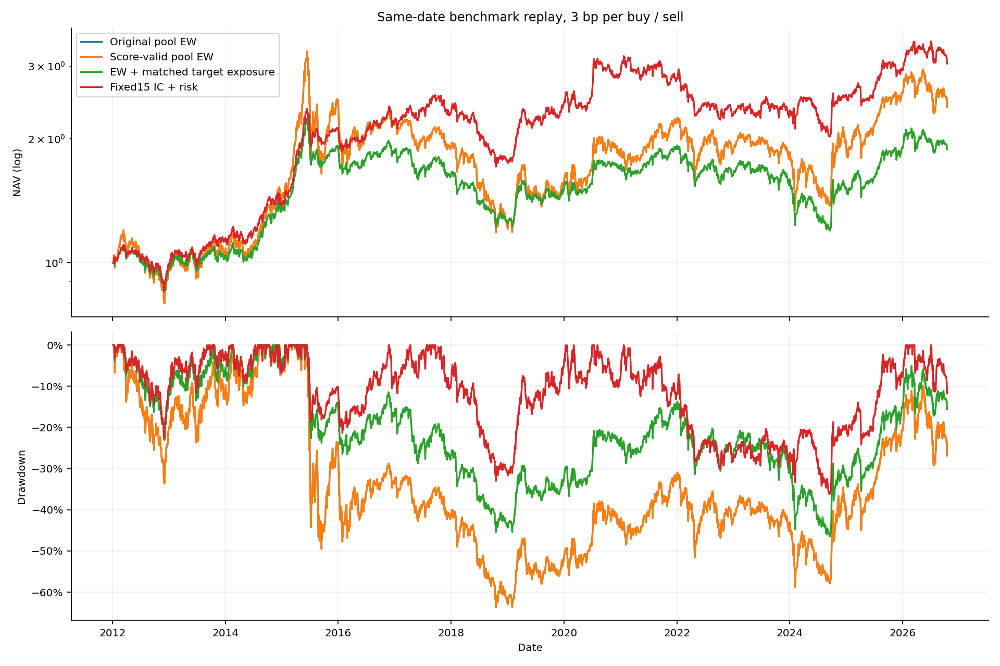
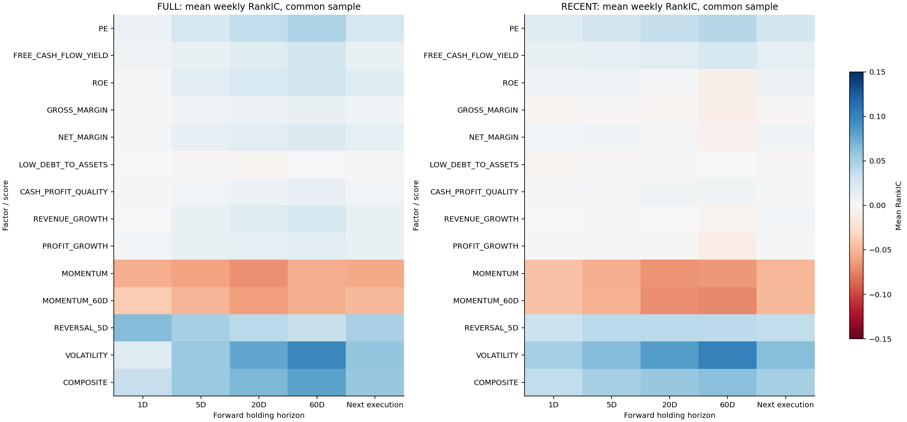
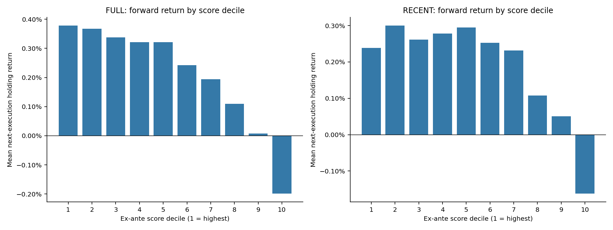
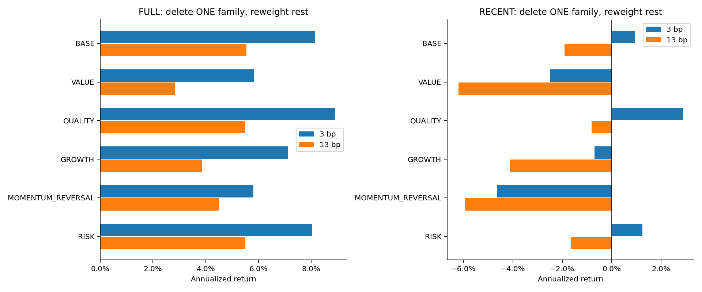
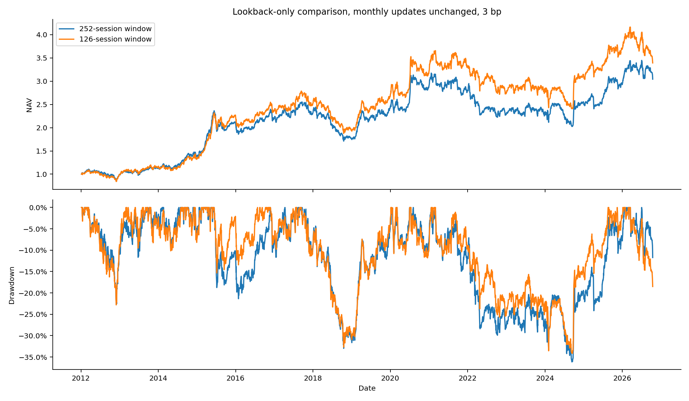

# 从四个合理怀疑出发：多因子小组合的收益诊断与回测验证

研究日期：2026-10-21。对象：IC＋分散缓冲固定15只＋仓位管理。状态：研究审计完成；没有自动改动因子准入、策略配置或六策略日报。

## 一、写作背景：小组合的规则越来越完整，收益却没有因此变得可靠

最近，我们围绕一个很实际的目标做了一轮研究：不再只把策略看成一个选股排名，而是尝试像管理一个小型股票组合那样，持有十几只股票，定期调整持仓，并控制集中风险和总仓位。

在[此前的小组合实验](SINGLE_ACCOUNT_ADAPTIVE_RESEARCH.md)中，我们已经比较过固定权重与RankIC加权、固定15只与动态10—20只，以及加入分散约束、持仓缓冲和仓位管理后的表现；随后又补上了“IC＋分散缓冲固定15只＋仓位管理”这一组。

这些规则分别处理不同的问题：RankIC决定因子如何分配权重；分散约束限制行业、主题和相关性集中；持仓缓冲减少排名轻微变化带来的换股；仓位管理决定有多少资金投入股票。它们让交易过程更加明确，却没有自动带来稳定的收益。

补测后的固定15只风控组合，在每笔买卖3bp成本下，全期累计收益为204.17%、年化8.14%，但最大回撤仍有36.15%；2021年以来累计收益仅5.34%、年化0.94%。将成本提高至13bp后，近年累计收益变成-10.16%。长历史上的盈利，并没有消除近期表现弱、成本敏感的问题。

讨论因此转向了三个更基础的问题：RankIC既然重要，为什么加上它未必让策略更好？股票究竟因为什么被调出组合？为什么用了多种常见因子，仍然难以获得可靠超额？

在当前实验中，股票的去留主要取决于综合因子排名、股票池资格、分散限制和持仓缓冲，并不是单独设置一个“跌到多少就卖”的模型。因此，账户表现不好，不能只归结为少了一个卖出开关。需要继续追问：用于排序的信息是否有效，有效信息是否落在最终买入的股票上，又是否在换仓和费用中被削弱？

当时我们提出了四个合理怀疑，但也明确说过：**它们还不是已经查明的原因。** 今天的工作，就是把这四个怀疑转换成可核对的实验。

## 二、最初的四个怀疑，各自在问什么

### 怀疑一：统一用五日收益评价，是不是看得太短

我们的历史IC权重使用五日收益标签。通俗地说，就是看今天因子分数较高的股票，在随后五个交易日是否通常排在收益较高的一边。

这个观察窗口接近周度换仓的节奏，但不一定适合所有信息。短期反转描述近期涨跌，而估值、盈利质量、成长描述的是不同性质的信息。于是有一个合理猜想：某些因子的作用可能不在五日内体现，统一用五日评分，会不会低估了它们？

但“基本面变化慢”并不等于“多等一段时间就一定赚钱”。我们需要让同一批信号接受1日、5日、20日、60日以及持有至下次调仓的评价，看改善是否真实存在、是否在近年也成立。

### 怀疑二：能给整个股票池排序，不代表最前面的15只最好

RankIC比较的是整个截面的分数排名与后续收益排名。一个分数可能善于把较差股票排到后面，却没有能力在高分股票内部继续精确区分第一名、第五名和第十五名。

这就产生了第二个猜想：总体排序有用，但我们只买很少的股票，是否把一种适合较宽组合的信号，过度集中到了最靠前的小范围？

所以这次不能只报告一个平均RankIC，还要分别看十个分数组、最高分的前10%、原始前15只，以及加上分散、缓冲和仓位管理后的实际组合。这里的原始Top15是“直接取分数最高的15只”，不等于最终受约束组合的15只名单。

### 怀疑三：因子名称很多，提供的信息是否没有那么多

我们使用了估值、盈利质量、成长、动量反转、风险五类共13个因子。但因子多不等于独立信息多。例如，ROE与净利率可能倾向于同一批公司；现金流相关指标也可能共享部分信息。

如果多个指标反复给同一类股票加分，表面上是多因子融合，实际可能仍集中在少数共同特征上。另一方面，两项指标即使整体相关不高，最终选出的少数股票也可能集中在同一行业或主题。

因此需要同时检查分数相关、入选名单重叠、共同风格暴露，再通过“每次删去一个因子类别”的对照观察变化。仅凭两项相关较高，还不足以决定删除哪一个。

### 怀疑四：历史平均RankIC是否在追随过去的有效性

原方案使用252个交易日的历史IC窗口，每月更新权重，并限制单因子权重和每次变化幅度。这些设计让权重不会随短期噪声剧烈跳动，但也引出了另一个担心：当因子有效性变化时，旧信息会不会留得太久？

这个怀疑包含两件不同的事。一件是“过去较强的因子，下个月是否仍然较强”；另一件是“同一个因子最近变强，下个月是否也会继续变强”。前者是因子之间的比较，后者才更接近对单个因子强弱变化的判断。

我们要分别检查这两种关系，再只增加一个126日窗口的对照。不能因为怀疑滞后，就直接认定更短窗口、每天调权或者更频繁换股一定更好。

## 三、把四个怀疑变成今天的验证方案

| 怀疑 | 今天具体做什么 | 结果不能被解释成什么 |
| --- | --- | --- |
| 五日评价低估慢因子 | 同一信号做五种期限评价，比较全期、近年及配对差异 | 不能把长标签IC较高直接当成延长持仓后一定赚钱 |
| 整体排序没有落实到Top15 | 比较十组、前10%、前15只与实际受约束组合，增加随机15只参考 | 不能把宽组合较好直接变成小账户买数百只的建议 |
| 多因子提供重复信息 | 检查相关、名单重叠和风格，再逐类删除对照 | 不能看到一个删除版本较好就自动淘汰该类因子 |
| IC权重跟不上变化 | 检查历史IC与下月IC的关系，只比较252日和126日窗口 | 不能把一次窗口对照的改善当作已经解决滞后 |

四项检验之外，还必须补两条共同参照：一是与当时股票池的等权组合比较，分清绝对收益和相对收益；二是分别看零成本、3bp和13bp，分清选股结果与交易实现的影响。

沿用2012-01-06至2026-10-15的评估区间，2011年预热。原有252日IC、每月更新、20%名义权重上限、每次最多5个百分点变化，以及分散、缓冲、风险预算和次日收盘撮合不变。只在事先声明的诊断中改变期限、删除一个因子类别或把窗口换成126日。

本轮完成五种收益期限、13个因子及融合分数的统计；39组组合回放（13个版本×零成本／3bp／13bp）；另有50条固定随机种子的Top15参考路径，在两档成本下回放。所有结果都报告，不选一个最好结果替换日报。

这些都是已经看过的历史，不是新发现的独立样本外。期限统计中的未来收益只用于事后评价，绝不用于当时的选股或权重。3bp为每笔买卖0.03%，13bp为0.13%，均不是完整现实费用单。

## 四、先补基准：低收益与没有超额不是一回事

原基础池等权包含当时基础股票池的全部成员；共同可评分池还要求原五类固定配方能生成有效综合分数。平均每周分别有2269和2269只股票。它们都随历史变化，不使用今天的股票清单回填过去。

“同目标仓位等权”使用主策略在各档成本下、当时已经生成的目标股票投入比例及交易日期；不重新使用等权池自身波动计算仓位。它隔离的是目标投入比例，不能保证实际仓位、行业、市值和Beta风险完全相同。

| 版本 | 全期年化 | 全期最大回撤 | 2021年以来年化 | 2021年以来累计 |
| --- | --- | --- | --- | --- |
| 原基础池等权 | 6.30% | -63.67% | 4.64% | 28.63% |
| 共同可评分池等权 | 6.30% | -63.66% | 4.64% | 28.63% |
| 同目标仓位的共同池等权 | 4.56% | -46.42% | 1.81% | 10.46% |
| 252日IC＋分散缓冲15只＋仓位管理 | 8.14% | -36.15% | 0.94% | 5.34% |

主策略相对同目标仓位等权基准，全期年化收益差为3.58个百分点，2021年以来为-0.87个百分点。这是两条CAGR的差，不是经过全部风格回归后的Alpha，也不是相对净值复合增长率。

提高到每笔买卖13bp成本后：

| 版本 | 全期年化 | 全期最大回撤 | 2021年以来年化 | 2021年以来累计 |
| --- | --- | --- | --- | --- |
| 原基础池等权 | 5.58% | -64.35% | 4.07% | 24.78% |
| 共同可评分池等权 | 5.58% | -64.35% | 4.07% | 24.78% |
| 同目标仓位的共同池等权 | 3.90% | -49.13% | 1.21% | 6.92% |
| 252日IC＋分散缓冲15只＋仓位管理 | 5.54% | -41.89% | -1.91% | -10.16% |



因此，必须分别回答“相对股票池有没有优势”“绝对收益是否足够”“承担的风险是否可接受”。不能因为年化很低就断言完全没有超额，也不能因为跑赢一个下跌基准就宣称可以实盘。

## 五、验证第一个怀疑：更长的评价期限能否改善慢因子的表现

这项检验保持当时的因子分数不变，只改变“在多长时间后评价它”。如果近年估值、质量和成长普遍在更长期限表现更好，才更支持“原来的五日评价偏短”；如果改善只发生在少数因子或早期阶段，就不能把它当成统一原因。

所有标签从信号后下一交易日收盘开始。1／5／20／60日均指入场后相应交易日数；NEXT为下一次周度调仓实际执行收盘。没有沿用早期信号日收盘建仓的诊断函数，因为那与本次撮合时点不同。

下表使用同一信号日、各期限均能评价的共同样本，以减少未来数据可用性不同造成的比较偏差。它只是统计样本，绝不反过来决定当时买哪些股票。因子来自原缓存的标准化分数，不等同于未经处理的原始财务字段；历史权重用的日度IC缓存另有原始有效值掩码，两者平均IC不能直接混为一个数。

由于60日标签必须完整成熟，共同期限比较实际覆盖2012-01-06至2026-07-10的743个信号日，并不是一直比较到10月。账户回放仍进行到2026-10-15；原生1日统计可用到10月9日，5日及NEXT到9月30日，20日到9月4日。不能用短期样本较新这一点伪装成期限差异。

| 因子 | 全期1日IC | 全期5日IC | 全期20日IC | 全期60日IC | 近年5日IC | 近年60日IC |
| --- | --- | --- | --- | --- | --- | --- |
| PE估值 | 0.008 | 0.026 | 0.037 | 0.047 | 0.028 | 0.043 |
| 现金流收益率近似 | 0.005 | 0.011 | 0.018 | 0.028 | 0.013 | 0.025 |
| ROE | 0.002 | 0.017 | 0.023 | 0.028 | 0.008 | -0.009 |
| 毛利率 | 0.001 | 0.006 | 0.009 | 0.011 | -0.001 | -0.010 |
| 净利率 | 0.003 | 0.013 | 0.017 | 0.021 | 0.006 | -0.006 |
| 低资产负债率 | 0.001 | -0.002 | -0.004 | -0.001 | -0.002 | -0.001 |
| 现金利润质量 | 0.002 | 0.004 | 0.008 | 0.013 | 0.002 | 0.006 |
| 营收增长 | 0.001 | 0.011 | 0.019 | 0.024 | 0.003 | -0.005 |
| 利润增长 | 0.004 | 0.011 | 0.015 | 0.016 | 0.002 | -0.012 |
| 中期动量 | -0.054 | -0.060 | -0.068 | -0.055 | -0.054 | -0.065 |
| 60日动量 | -0.038 | -0.051 | -0.063 | -0.053 | -0.052 | -0.072 |
| 5日反转 | 0.065 | 0.050 | 0.041 | 0.033 | 0.040 | 0.039 |
| 低波动 | 0.019 | 0.056 | 0.078 | 0.097 | 0.065 | 0.101 |
| 融合分数 | 0.034 | 0.056 | 0.068 | 0.080 | 0.050 | 0.062 |



仅60日IC高于5日还不够，需看是否跨阶段一致，以及高分组是否跑赢同期限股票池。以下给出近年60日减5日IC的配对差异，使用12个周度滞后的HAC标准误估计点式区间，考虑长标签重叠：

| 因子 | 近年60日IC减5日IC | 点式95%区间 |
| --- | --- | --- |
| 现金利润质量 | 0.004 | [-0.002, 0.011] |
| 融合分数 | 0.012 | [-0.021, 0.045] |
| 现金流收益率近似 | 0.012 | [-0.006, 0.030] |
| 毛利率 | -0.009 | [-0.026, 0.008] |
| 低资产负债率 | 0.001 | [-0.010, 0.013] |
| 中期动量 | -0.011 | [-0.031, 0.009] |
| 60日动量 | -0.020 | [-0.048, 0.007] |
| 净利率 | -0.012 | [-0.039, 0.015] |
| PE估值 | 0.015 | [-0.017, 0.047] |
| 利润增长 | -0.013 | [-0.028, 0.002] |
| 营收增长 | -0.008 | [-0.029, 0.013] |
| 5日反转 | -0.001 | [-0.014, 0.012] |
| ROE | -0.016 | [-0.053, 0.020] |
| 低波动 | 0.036 | [0.005, 0.068] |

这里的区间未做多重检验校正，不能看到某一个不跨零就宣布发现有效因子。长历史也不是市场结构稳定的保证。即使长期标签较好，也没有在本轮证明“改成持有60日”的可交易策略能取得相同收益。

未来缺价不填零、不用下一只股票顶替，覆盖情况另列：

| 期限 | 平均全截面覆盖率（跨因子） | 平均Top15覆盖率（跨因子） |
| --- | --- | --- |
| 1 | 99.55% | 99.43% |
| 20 | 98.30% | 98.03% |
| 5 | 99.05% | 98.88% |
| 60 | 97.13% | 96.77% |
| NEXT | 99.07% | 98.92% |

同时保留各期限原生样本统计于`horizon_summary.csv`。共同样本仍受可评价性选择影响，这不是完整的退市收益重建。样本末尾不能走完60日的信号不进入共同期限比较，但仍参与已经成熟的短期统计。

回到最初的怀疑：期限确实影响评价，但结果没有显示“质量和成长只要多等一些时间就有效”。近年PE和低波动的长标签均值更高，ROE、净利率、利润增长的60日IC却转负，而且多数期限差的区间仍跨零。因此，这个怀疑得到的是部分支持，不能据此统一改成长周期持有。

## 六、验证第二个怀疑：全截面的排序优势是否集中在前15只

这项检验沿着选股到持仓的过程逐层比较。首先看高分股票群体是否优于低分群体，再看把范围缩到15只之后如何变化，最后看实际约束与交易成本如何改变结果。

先在看不到未来收益的条件下给全体候选股票分组，再评价这些固定组的收益。缺价只降低可评价覆盖率，不能让另一只股票补进前15名。

下面是融合分数的“下一次实际调仓”平均持有期统计。FULL为全期，EARLY为2012–2015，MID为2016–2020，RECENT为2021年至终点。收益差是每次持有期均值，不是累计净值，也未扣交易成本。

| 时期 | 整体RankIC | 前10%减股票池 | 前15只减股票池 | 前15只减前10% | 前15只未来收益覆盖率 |
| --- | --- | --- | --- | --- | --- |
| FULL | 0.056 | 0.17% | 0.09% | -0.08% | 99.21% |
| EARLY | 0.055 | 0.23% | 0.22% | -0.01% | 98.19% |
| MID | 0.068 | 0.25% | 0.27% | 0.01% | 99.22% |
| RECENT | 0.048 | 0.05% | -0.15% | -0.20% | 99.91% |



第1组为最高分，第10组为最低分。图中展示各组的平均持有期收益，不是每组年化收益。整体RankIC、前10%表现和前15只表现是不同问题，不能只看其中一个。

真正进入组合回放后，各阶段如下：

| 版本 | 全期年化 | 全期最大回撤 | 2021年以来年化 | 2021年以来累计 |
| --- | --- | --- | --- | --- |
| 共同可评分池等权 | 6.30% | -63.66% | 4.64% | 28.63% |
| 融合分数前10% | 15.49% | -39.51% | 7.98% | 53.16% |
| 融合分数前15只，无新增约束 | 8.45% | -53.00% | -3.51% | -18.01% |
| 分散缓冲15只，无仓位管理 | 9.68% | -49.00% | 0.57% | 3.21% |
| 252日IC＋分散缓冲15只＋仓位管理 | 8.14% | -36.15% | 0.94% | 5.34% |

扣费前后：

| 版本 | 零成本年化 | 3bp年化 | 13bp年化 |
| --- | --- | --- | --- |
| 共同可评分池等权 | 6.52% | 6.30% | 5.58% |
| 融合分数前10% | 16.82% | 15.49% | 11.17% |
| 融合分数前15只，无新增约束 | 10.13% | 8.45% | 3.04% |
| 分散缓冲15只，无仓位管理 | 10.77% | 9.68% | 6.12% |
| 252日IC＋分散缓冲15只＋仓位管理 | 8.93% | 8.14% | 5.54% |

两个值得注意的读法：第一，原始Top15即使不扣费用，全期年化10.13%仍低于前10%组合的16.82%，所以问题不能全部归咎于成本。第二，主策略从零成本8.93%降至3bp的8.14%，再降至13bp的5.54%，成本确实进一步侵蚀优势。前10%通常涉及数百只股票，是诊断参照，不是在建议小账户照搬持仓规模。

前10%到前15只改变集中度；前15只到分散缓冲15只同时加入行业、主题、相关性和持仓缓冲；最后加入仓位管理。这是策略阶段对照，不是各机制互相独立的因果分解，不能把CAGR差直接相加。另存的`attribution_log_returns.csv`使用年化对数收益差表达可相加的路径差异，也仍不是唯一的经济因果归因。

随机参考结果：

| 成本 | 时期 | 原始Top15年化 | 随机15只年化中位数 | 随机样本5%—95%分位 | Top15超过随机路径数 |
| --- | --- | --- | --- | --- | --- |
| 2bp | FULL | 8.45% | 3.19% | -2.81%—7.52% | 49/50 |
| 2bp | RECENT | -3.51% | 0.52% | -6.48%—7.53% | 10/50 |
| 13bp | FULL | 3.04% | -6.75% | -11.95%—-2.83% | 50/50 |
| 13bp | RECENT | -8.82% | -9.13% | -15.30%—-2.90% | 27/50 |

随机15只每周从同一共同池无放回抽取，50条路径事先固定种子，没有搜索幸运路径。它没有行业匹配和持仓缓冲，净收益差还包含换手差异；“超过多少条随机路径”不是统计显著性p值，更不能证明策略具有独立Alpha。

这部分为第二个怀疑提供了最清晰的证据：近年整体RankIC仍为正，原始Top15却平均每个持有期落后股票池约0.15个百分点，而前10%仍领先约0.05个百分点。这里说的是平均持有期收益差，不是年化。它提示我们要查高分范围内的选股与集中问题，而不是继续把“整体RankIC为正”当成最终15只一定有效的保证。

## 七、验证第三个怀疑：多个因子是否在重复提供同一信息

先看是否相似，再看是否选到同样的股票，最后看删去一类后组合有什么变化。三层证据结合，才能区分“指标相关”与“对当前组合没有增量价值”。

全期绝对排名相关最高的八对因子：

| 因子A | 因子B | 平均排名相关 | 前15只重叠比例 | 前10%集合Jaccard |
| --- | --- | --- | --- | --- |
| 现金流收益率近似 | 现金利润质量 | 0.737 | 12.20% | 23.78% |
| ROE | 净利率 | 0.693 | 12.17% | 21.12% |
| PE估值 | ROE | 0.611 | 4.00% | 15.60% |
| 毛利率 | 净利率 | 0.597 | 18.25% | 30.74% |
| 中期动量 | 60日动量 | 0.486 | 26.83% | 28.62% |
| 营收增长 | 利润增长 | 0.409 | 9.56% | 18.05% |
| 中期动量 | 5日反转 | -0.403 | 2.32% | 4.37% |
| ROE | 利润增长 | 0.401 | 12.02% | 12.24% |

排名相关在[-1,1]之间；Top15重叠比例为共同股票数除以15；Jaccard为前10%两个集合的交集数量除以并集数量。相关很高不等于完全重复，相关低也不能排除它们在同一行业主题上共同集中。

各单因子Top15的行业和共同风格分数：

| 因子Top15 | 最大单行业平均占比 | 科技主题平均占比 | 低波动分数均值 | PE估值分数均值 | 短反转分数均值 |
| --- | --- | --- | --- | --- | --- |
| 现金利润质量 | 20.52% | 18.60% | -0.127 | -1.899 | 0.028 |
| 现金流收益率近似 | 23.90% | 28.24% | 0.417 | 0.247 | 0.073 |
| 毛利率 | 23.95% | 23.23% | -0.154 | 0.098 | -0.006 |
| 低资产负债率 | 28.48% | 7.79% | -0.455 | -0.476 | 0.013 |
| 中期动量 | 22.91% | 26.83% | -2.093 | -0.500 | -1.729 |
| 60日动量 | 22.61% | 27.49% | -1.983 | -0.568 | -0.925 |
| 净利率 | 18.84% | 11.82% | 0.018 | 0.282 | -0.007 |
| PE估值 | 43.69% | 6.56% | 0.435 | 1.037 | 0.035 |
| 利润增长 | 21.68% | 26.58% | -0.281 | 0.097 | -0.041 |
| 营收增长 | 20.79% | 22.20% | -0.313 | -0.158 | -0.018 |
| 5日反转 | 22.80% | 19.29% | -1.468 | -0.295 | 2.564 |
| ROE | 24.02% | 24.20% | -0.149 | 0.458 | -0.022 |
| 低波动 | 26.78% | 30.08% | 1.838 | 0.232 | 0.065 |

低波动、估值、反转分数均值是原标准化分数，不是风险贡献。行业用当时缓存，未知行业也计入；本轮没有重新构造完整市值、Beta和主题风险模型，因此不能用这张表证明所有隐含共同风险都已排除。

进一步每次删除一个类别，剩余原权重机械归一化，不重新估计它们的IC权重、不搜索新配方：

| 版本 | 3bp全期年化 | 13bp全期年化 | 3bp近年年化 | 13bp近年年化 | 3bp全期回撤 |
| --- | --- | --- | --- | --- | --- |
| 252日IC＋分散缓冲15只＋仓位管理 | 8.14% | 5.54% | 0.94% | -1.91% | -36.15% |
| 删除估值类 | 5.83% | 2.84% | -2.50% | -6.21% | -54.32% |
| 删除盈利质量类 | 8.91% | 5.50% | 2.89% | -0.81% | -41.09% |
| 删除成长类 | 7.12% | 3.87% | -0.69% | -4.11% | -32.64% |
| 删除动量反转类 | 5.80% | 4.51% | -4.64% | -5.96% | -42.59% |
| 删除波动风险类 | 8.02% | 5.49% | 1.25% | -1.66% | -35.16% |



重要边界：删除后归一化会提高剩余因子权重，原始20%上限是删除前分配规则，不能假装删除后仍保持不变。删除不同类别后的历史最高单因子权重分别为：VALUE: 33.33%; QUALITY: 35.15%; GROWTH: 27.08%; MOMENTUM_REVERSAL: 25.00%; RISK: 25.00%。因此这是信息删除诊断，不是已经满足原风险预算的生产候选。

删除一类后的改善可能来自减少重复、改变风格、降低换手或改变风险仓位。需要结合相关和选股重叠判断，不能单凭收益较高就自动删除因子。本轮不会调用自动冗余剔除或修改因子准入。

例如删除盈利质量类，3bp全期年化由8.14%升至8.91%，但最大回撤由-36.15%扩大至-41.09%；13bp全期年化又略低于原方案。近年表现虽改善，13bp下仍为负。这不是一个“删掉质量就成功”的结果。另外，原252日主策略中两个动量因子在本次评估期的实际权重均为零，因此删除“动量反转类”主要删除的是5日反转，不能把收益变化说成动量因子的贡献。

## 八、验证第四个怀疑：过去强的信号，下个月是否仍强

这部分先检验历史信息与后续表现的关系，再检验缩短窗口后的账户结果。两个问题都要看，不能只凭126日版本的净值更高，就倒推252日滞后是已经确定的原因。

每个月更新时，只读取标签已成熟的历史IC，随后观察下一个完整日历月的因子IC。整个评价月及其收益标签没有全部实现时，不报告该月结果。下月IC只是事后验证，不能进入当时权重。

| 时期 | 历史窗口 | 可评价月份 | 过去与下月的因子排名相关 | 点式95%区间 | IC加权相对等权的下月IC差 | 调权方向与下月IC乘积之和均值 | 保留旧权重月份 |
| --- | --- | --- | --- | --- | --- | --- | --- |
| FULL | 252 | 176 | 0.484 | [0.437, 0.531] | 0.021 | -0.000 | 9 |
| FULL | 126 | 176 | 0.470 | [0.420, 0.519] | 0.021 | -0.000 | 13 |
| RECENT | 252 | 68 | 0.469 | [0.392, 0.546] | 0.021 | -0.001 | 6 |
| RECENT | 126 | 68 | 0.452 | [0.362, 0.541] | 0.020 | -0.000 | 10 |

“过去与下月的因子排名相关”是每月在13个因子之间比较，再对月份取平均；并不是股票截面的RankIC。“IC加权相对等权的下月IC差”是加权平均IC与因子等权平均IC之差；“调权方向与下月IC乘积之和”观察增减权方向与随后IC的关系。两者都不是账户收益，不能换算成投资回报率。

既有因子之间长期能力差异，也有同一因子的阶段变化。因此另存`lag_factor_summary.csv`，逐因子看历史IC变化与随后IC变化的时间相关性；不能把跨因子排序较好误读成每个因子的择时都有效。

| 因子 | 252日窗口：全期时间相关 | 252日窗口：近年时间相关 | 126日窗口：近年时间相关 |
| --- | --- | --- | --- |
| PE估值 | 0.063 | -0.162 | -0.170 |
| 现金流收益率近似 | 0.132 | -0.076 | -0.091 |
| ROE | 0.206 | -0.211 | -0.167 |
| 毛利率 | 0.098 | -0.087 | -0.145 |
| 净利率 | 0.166 | -0.182 | -0.222 |
| 低资产负债率 | 0.007 | 0.013 | 0.060 |
| 现金利润质量 | 0.063 | -0.024 | -0.121 |
| 营收增长 | 0.098 | -0.040 | -0.092 |
| 利润增长 | 0.237 | 0.031 | 0.042 |
| 中期动量 | 0.007 | -0.062 | 0.088 |
| 60日动量 | 0.055 | -0.148 | -0.166 |
| 5日反转 | 0.257 | 0.090 | -0.016 |
| 低波动 | 0.037 | -0.136 | -0.124 |

这张表问的是“某个因子最近比自己过去更强，是否意味着下个月也更强”。例如252日窗口下，ROE近年的时间相关约-0.21，PE约-0.16，而月度跨因子排名相关仍为正。两者并不矛盾：能够分辨长期较强与较弱的因子，不等于能够准确择时它们的短期变化。这里仍是未经多重检验调整的描述，不是反向调权指令。

最后只把252日窗口换成126日，120个有效观测要求、月度更新、权重上限、变化速度、缺证据保留上一版权重等全部保持不变：

| 版本 | 全期年化 | 全期最大回撤 | 2021年以来年化 | 2021年以来累计 |
| --- | --- | --- | --- | --- |
| 252日IC＋分散缓冲15只＋仓位管理 | 8.14% | -36.15% | 0.94% | 5.34% |
| 仅改126日IC窗口 | 8.96% | -34.16% | 1.07% | 6.07% |

13bp成本下：

| 版本 | 全期年化 | 全期最大回撤 | 2021年以来年化 | 2021年以来累计 |
| --- | --- | --- | --- | --- |
| 252日IC＋分散缓冲15只＋仓位管理 | 5.54% | -41.89% | -1.91% | -10.16% |
| 仅改126日IC窗口 | 6.46% | -39.78% | -1.63% | -8.74% |



短窗口若有所改善，也只能说明这一组历史参数对照的结果，不能直接证明根因是滞后；噪声、保留旧权重的频率和股票选择都可能变化。没有增加每日更新、更多窗口或逆向IC规则，也没有自动部署较好的窗口。

## 九、把结果放回最初的四个怀疑

| 原来的怀疑 | 本轮证据 | 现在能说什么 |
| --- | --- | --- |
| 五日评价太短，低估慢因子 | 部分估值、现金流、低波动分数在长标签上均值更高；近年ROE、净利率、利润增长等60日IC却转负 | 部分符合，但不能用“期限太短”统一解释；近年多数期限差的统计区间仍跨零 |
| 全截面排序没有落实到前15只 | 近年融合分数整体RankIC仍为正，但原始Top15平均每个持有期落后股票池约0.15个百分点，前10%仍领先约0.05个百分点 | 本轮最清晰的薄弱环节是高分尾部集中，不代表任意15只组合必然无效 |
| 因子重复押注同一信息 | 现金流两项排名相关约0.74，ROE与净利率约0.69；不同类别删除结果不一致 | 有局部重复，不能概括为13个因子都一样，也不能直接按相关性删掉一类 |
| 历史IC调权太慢 | 126日窗口全期略好，但近年13bp成本下仍亏损；预测下月因子排名的统计没有同步提升 | 尚不能确认“改快就能解决”；单因子自身的强弱变化也比跨因子能力排序更难预测 |

这次也修正了一个过于笼统的判断：不能把问题概括成“因子完全没有超额”。3bp成本下，主策略全期年化8.14%，同目标仓位等权为4.56%；但2021年以来分别只有0.94%和1.81%。全期有相对优势，不等于近年仍可靠，更不等于已经达到小资金实盘的要求。

四个怀疑并没有全部被证实，也没有归结成一个简单答案。但研究重点比开始时更清楚了：**为什么高分股票群体的优势，在集中到15只、实际换仓并扣费后变弱。** 这需要进一步的持仓级证据，而不是直接增加一个卖出模型或更快的调仓规则。

## 十、下一步：沿着最明确的线索继续查

保留现有日报和原方案作为对照，不把126日窗口或删除质量类自动上线。下一轮优先做小组合的持仓归因：分开查看原始高分股、因分散约束被替换的股票、因缓冲保留的旧仓，分别记录后续收益、行业风格、换手与成本，并核对极端分数是否集中在财务缺失填补或近似字段上。

然后才预先固定一个针对明确问题的改动，在未参与选择的新时间上验证。历史阶段都已被反复研究，不能再把其中一段重新命名成“完全没看过的测试集”。如果新数据还不够，就继续纸面记录，而不是用再一次历史最优参数代替验证。

从四个合理怀疑出发，今天完成的是一次诊断，而不是一次策略修复。我们确认了哪些地方有问题的迹象，也明确了哪些说法还缺证据。**总体排序有信息，但小组合尾部选择、阶段稳定性和交易实现尚未把这些信息可靠地转成净收益。** 下一步要解决的，就是这个更具体的问题。

## 附录：核验、局限和复现文件

新增5项测试与全仓库共491项测试通过。轻量回放器只省略大股票池的逐笔明细以控制内存，撮合规则不变；先通过缺价、现金、空仓和HOLD测试，再与已封存的15只风控组合在两档成本下逐日核对净值和执行记录。

独立审计抽样重算132组因子期限观测，并检查共同期限样本、权重成熟时点、费用现金、随机计划成员资格和同目标仓位基准的执行日期。旧实验结果与六策略账户哈希保持不变。

未解决的现实限制仍包括原始财务修订、行业历史覆盖、现金流近似字段、退市收益缺失、整手与实际费用、涨跌停和容量。没有报价的旧仓不能伪造退出，仍会按旧价估值；仓位模型仍基于拟持有篮子。这些限制影响实盘解释，不能被测试通过所替代。

协议：`research_protocols/20261021_factor_diagnosis_v1.json`。

结果目录：`output/factor_diagnosis_20261021/`。主要表格为`horizon_summary.csv`、`horizon_paired_difference.csv`、`performance.csv`、`subperiods.csv`、`redundancy_summary.csv`、`factor_exposures.csv.gz`、`lag_monthly.csv`、`lag_factor_summary.csv`、`random_performance.csv`及`attribution_log_returns.csv`。

```bash
OPENBLAS_NUM_THREADS=1 OMP_NUM_THREADS=1 MPLCONFIGDIR=/private/tmp/quant-mpl .venv/bin/python scripts/run_factor_diagnosis.py
OPENBLAS_NUM_THREADS=1 MPLCONFIGDIR=/private/tmp/quant-mpl .venv/bin/python scripts/validate_factor_diagnosis.py
OPENBLAS_NUM_THREADS=1 MPLCONFIGDIR=/private/tmp/quant-mpl .venv/bin/python scripts/report_factor_diagnosis.py
.venv/bin/python -m unittest tests.test_factor_diagnosis -v
```

冻结源代码或协议变化后必须使用新的输出目录，不覆盖原结果。本轮所有对照都是诊断结果，不构成自动买卖或实盘准入建议。
