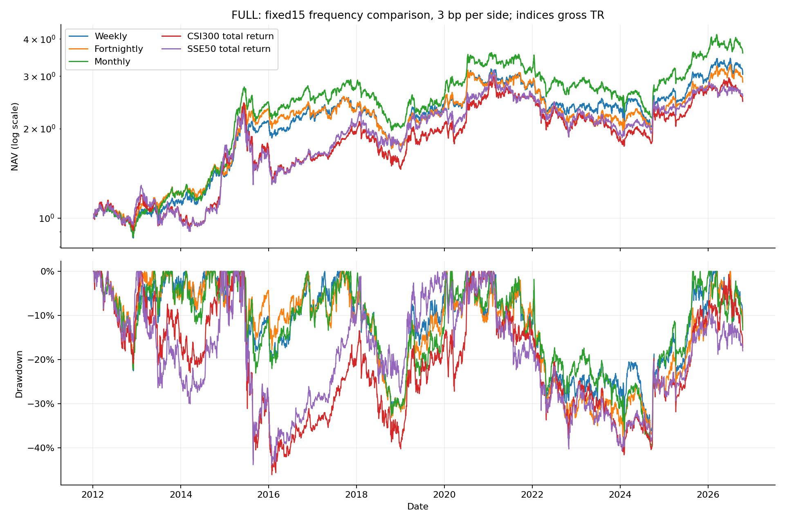
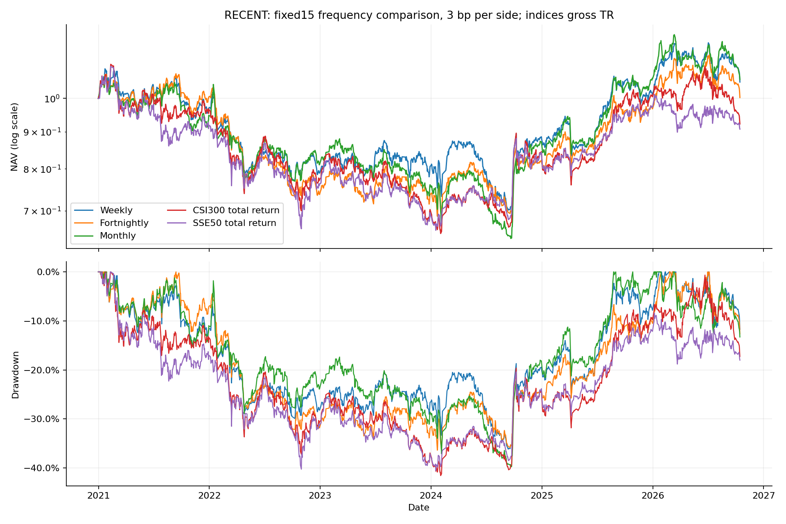
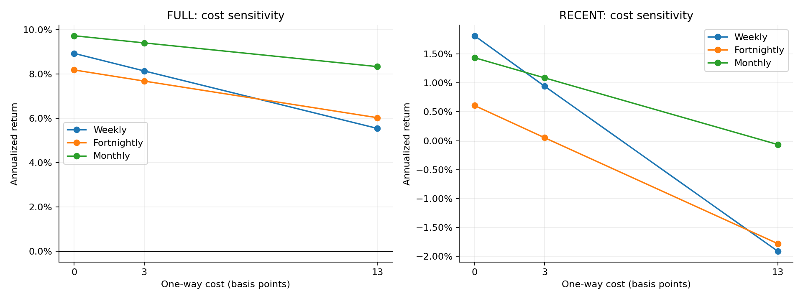
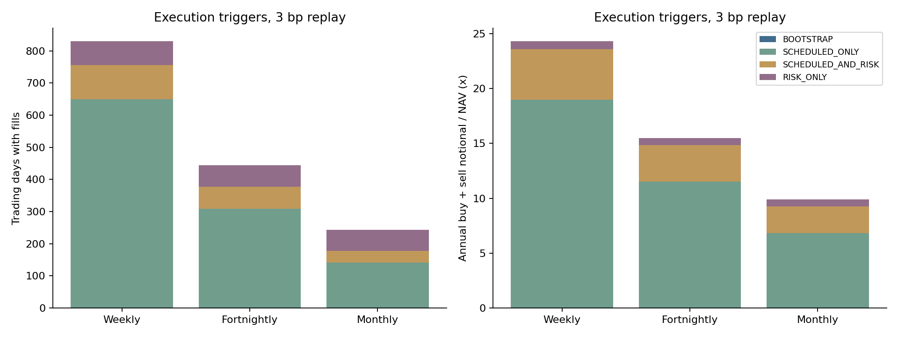

# 从每周换股到每月换股：15只多因子组合与沪深300、上证50的同期对照

研究日期：2026-10-22。状态：历史回放与独立核验完成；未修改六策略前向账户，未自动选择或上线历史最优频率。

## 一、背景：昨天发现成本敏感，今天只改变换股频率

昨天的[四个怀疑诊断](FACTOR_RETURN_DIAGNOSIS.md)发现：整体因子排序仍有信息，但压缩到前15只后，优势没有稳定兑现；加入分散和仓位管理可以降低风险，却没有解决近年的弱收益。提高费用后，结果进一步变差。

于是这次提出一个可检验的问题：沿用同一套“RankIC调权＋分散约束＋持仓缓冲＋固定15只＋仓位管理”，把每周换股改成每两周或每月换股，能否保留选股收益并减少交易损耗？

没有新增股息率、应计利润率等候选因子，也没有同时改变IC期限或股票数量。研究目标不是挑一条最好看的曲线，而是区分“交易过频”与“持有更久后信号变弱”两种可能。

## 二、先认识这套持仓方式：选谁、留谁、投多少

本轮研究沿用的方案是：**历史RankIC调权＋分散约束＋持仓缓冲＋固定15只＋总仓位管理。**

这是单独的研究组合，**不是六策略日报正在运行的50只方案，也不是此前的动态10—20只方案**。2026年10月21日的诊断以它的周度版本为核心；今天保留这套规则，只比较不同的定期换股频率。

### 1. 因子决定哪些股票更值得选，但因子权重不等于股票仓位

沿用估值、盈利质量、成长、动量反转、风险五类共13个传统因子，使用过去252个交易日窗口内已经成熟的五日收益标签，计算平均RankIC，并按月更新权重。所谓“成熟”，是指所评价的五日收益在调权前已经完整发生，不能把尚未实现的未来收益拿来决定今天的权重。

单因子名义权重最高20%，每次更新最多变化5个百分点；满足历史观测要求的正向因子不足以完成限额分配时，保留上一版权重。这里不是ICIR加权，也不是每天重新寻找历史最优配方。**因子权重决定怎样给股票打分，股票权重才决定账户资金怎样分配。**

### 2. 目标15只，不等于直接买综合分数前15名

程序从综合分数前100名中挑选，固定以15只为目标，同时限制集中度：

- 单行业最多3只。
- 指定科技主题合计最多5只，本实验包括电子、计算机、通信、传媒、电力设备。
- 新入选股票与已选股票的历史收益相关系数不能高于0.8，相关数据不足也会按规则排除。

因此，排名第8的股票可能因为行业已经选满而没能入选，排名第25的股票反而可能进入组合。这些是选股时的目标约束，不能保证之后价格漂移、停牌或实际成交后的风险始终不变；不同行业也不意味着不存在其他共同风险。

### 3. 给原持仓留一个缓冲区，减少轻微排名变化引发的换股

已有持仓如果仍在前30名，就有优先保留资格，但还要满足股票池资格和分散限制。

例如，一只股票从第12名退到第18名，不会仅仅因为跌出前15名就立即卖掉。它可以减少反复买卖，但不是无条件保留，也不是“只要没跌到止损线就一直持有”。**缓冲的代价是：可能让已经变弱的股票继续留在组合里。**

### 4. 股票等权，不代表账户一直满仓

选满15只时，各股平分目标股票仓位。例如账户资金30万元、股票仓位60%，目标投入股票18万元，每只约1.2万元，即每只占账户4%；剩余12万元留现金。

若约束下只选出12只，每只仍按“股票仓位预算÷15”配置，空缺留现金，不把剩余股票强行加满。上面的金额只是规则示例，未考虑整手和费用。

总股票仓位根据拟持有篮子过去60个交易日的波动估计，目标年化波动15%，预算限制在20%—100%。**15%是管理目标，不是实际波动上限，更不是最大回撤保证。** 预算也不等于实际成交后的仓位，未选满或无法成交都会造成差异。

风险每天检查，仍保留10个百分点的调整门槛与5交易日冷却期；风险历史不足时保留原预算。选股和风控信号都在下一交易日收盘模拟执行，而不是用当天收盘结果决定当天收盘买入。

### 5. 优势：风险和交易行为更可控，历史上确实降低了波动

这套方案把四件事分开处理：因子决定选股倾向，分散约束限制集中，缓冲减少小幅排名变化造成的换股，仓位管理控制投入股票的总金额。

2026年10月21日的诊断提供了如下对照。区间同为2012年1月至2026年10月15日，每笔买卖3bp成本，两组都按周换股：

| 持仓方式 | 年化收益 | 年化波动 | 最大回撤 |
| --- | --- | --- | --- |
| 按相同RankIC融合分数直接取前15只，不加分散、缓冲和仓位管理 | 8.45% | 26.36% | -53.00% |
| 加入分散、缓冲及总仓位管理，仍以15只为目标 | 8.14% | 16.15% | -36.15% |

本段历史中，收益略低，波动和回撤明显下降。这是整套机制的对照效果，不能全部归功于某一项约束。目标15只也更接近我们想研究的小账户形态，但此次使用可分割股数，尚未完整模拟整手、最低佣金、涨跌停和容量，不能等同于真实小资金交易已经验证通过。

### 6. 不足：能管理风险，不等于已经有可靠的选股收益

原诊断暴露了四个问题：

- **整体排序有效，最靠前的小范围未必最好。** 2021年以来整体RankIC仍为正，但原始Top15的平均持有期收益落后股票池，前10%股票群体则仍有优势。这里的“原始Top15”不是受约束后的实际15只，不能混为一谈。
- **近年收益偏弱。** 周度完整组合在3bp下全期年化8.14%，但2021年以来只有0.94%，低于同期同目标仓位等权基准的1.81%。这个基准与后文满仓的原股票池等权基准不同。
- **缓冲没有消除成本敏感性。** 周度版本从3bp提高至13bp后，全期年化由8.14%降至5.54%，近年由0.94%降至-1.91%。
- **约束和缓冲都有取舍。** 分散规则可能挡住后来上涨的股票，缓冲也可能留下后来走弱的股票。原诊断尚未逐笔查明这些取舍的净贡献，不能把它们直接宣布为已经查明的亏损原因。

所以，这套方案的价值是让小组合的持仓过程更明确，并在已有历史中降低风险；它尚未证明能够稳定创造超额。**这正是今天继续比较调仓频率的背景：保留原持仓逻辑，观察少换股能否改善收益与成本的取舍，而不是预先认定持有更久一定更好。**

## 三、三种方案：只有定期重选股票的日历不同

| 项目 | 每周 | 每两周 | 每月 |
| --- | --- | --- | --- |
| 定期选股 | 完整W-FRI周的最后交易日 | 从首次信号所在周起，每隔两个日历周 | 完整日历月的最后交易日 |
| 初次建仓 | 三组均2012-01-06形成信号、2012-01-09收盘执行 | 同左 | 同左 |
| 后续成交 | 下一交易日收盘 | 下一交易日收盘 | 下一交易日收盘 |
| 风控检查 | 每个交易日 | 每个交易日 | 每个交易日 |
| 选股信号总数（含首次建仓） | 756 | 378 | 178 |

双周采用固定日历周相位，节假日无交易的一周也计入日历，不会按行情或长假重新选择起点。本轮没有搜索另一种双周起始相位；月末效应与频率效应也未完全分离，因此结果只适用于这组事先固定的日历。终点为2026-10-15，不能把未结束的最后一周或10月当成已完成周期提前调仓。

三组均使用上一节的持仓与风控规则。因子权重统一在每月首个周度信号日更新，各版本在自己的定期重选日读取最新可用权重。**月度换股版并没有把五日IC标签同时改成20日，也没有改变权重更新日历**，否则就不再是单独比较换股频率。

**每月换股不等于每月只交易一次。** 风险触发时，仍可能在两次定期换股之间调整目标仓位。沿用的实现会恢复拟持有篮子的等权目标，所以不一定只是按实际持仓同比例缩放，也可能调整价格漂移后的权重。定期换股和风控同日触发的费用单独归为“共同触发”，不作无法识别的强行拆分。

## 四、数据与指数口径：真正月末，真正同期

旧实验仅缓存了周度因子快照。本次按真实月末，用同一原始行情、财务公告可用时间、历史行业和基础池硬风险规则重新计算，不能拿“最近一个星期五的名单”冒充月末名单。每个季度选取重叠周度日期，重建的13因子标准化面板与旧缓存逐项核对通过。

股票池仍是当时的基础可交易池，不是改用沪深300或上证50成分股选股；这两个指数只作市场参照。指数行情来自Tushare `index_daily`，分段下载后核查代码、日期唯一性、正价格与完整交易日覆盖，并保留数据哈希。

主对照使用沪深300全收益H00300.CSI、上证50全收益H00016.CSI；另外展示000300.SH、000016.SH价格指数。上证50全收益在Tushare的分类后缀是CSI，不是价格指数的SH。全收益包含分红再投资，价格指数不包含；不能只比较较低的价格指数就宣布完整超额。

指数统一从首次执行日收盘起买入持有，初始信号日净值设为1，不提前赚取首次执行前的指数涨跌。指数未扣ETF费率、跟踪误差和买卖费用。策略沿用供应商复权价格研究口径，并非逐笔现实股息再投资重建，因此仍保留口径差异提醒。

研究区间为2012-01-06至2026-10-15，第一次股票成交为1月9日。累计收益按相同起止净值计算；年化收益、波动与夏普沿用原工程每年252交易日、无风险收益率0的约定。2026年逐年收益只截至10月15日，不是完整年度。

## 五、全期结果：三种频率与两条全收益指数

下表策略及股票池基准按每笔买卖3bp，即0.03%；指数为不扣交易费用的全收益买入持有。

| 方案 | 累计收益 | 年化收益 | 年化波动 | 夏普（无风险利率0） | 最大回撤 |
| --- | --- | --- | --- | --- | --- |
| 每周换股 | 204.17% | 8.14% | 16.15% | 0.565 | -36.15% |
| 每两周换股 | 186.35% | 7.68% | 16.03% | 0.542 | -37.54% |
| 每月换股 | 258.82% | 9.40% | 16.52% | 0.627 | -39.78% |
| 沪深300全收益指数 | 146.90% | 6.56% | 21.29% | 0.405 | -46.06% |
| 上证50全收益指数 | 156.91% | 6.86% | 21.34% | 0.418 | -43.80% |
| 原股票池每周等权基准 | 138.42% | 6.30% | 25.99% | 0.366 | -63.66% |

净值图采用对数纵轴；回撤从各自此前最高净值计算。主策略会留现金，两条指数始终满仓，不应把收益差解释为已经控制Beta与风格后的Alpha。

## 六、不能只看长历史：单独看2021年以来

| 方案 | 累计收益 | 年化收益 | 年化波动 | 夏普（无风险利率0） | 最大回撤 |
| --- | --- | --- | --- | --- | --- |
| 每周换股 | 5.34% | 0.94% | 16.46% | 0.139 | -36.15% |
| 每两周换股 | 0.29% | 0.05% | 15.91% | 0.083 | -36.44% |
| 每月换股 | 6.18% | 1.09% | 17.07% | 0.149 | -39.78% |
| 沪深300全收益指数 | -7.79% | -1.45% | 18.17% | 0.010 | -41.56% |
| 上证50全收益指数 | -9.27% | -1.74% | 17.36% | -0.014 | -40.54% |
| 原股票池每周等权基准 | 28.63% | 4.64% | 23.55% | 0.311 | -40.26% |

这一段沿用账户历史持仓状态，不在2021年重新选一次股票或重置权重。展示曲线按2020年末净值归一化，确保包含2021年第一个交易日的收益。

分阶段年化收益：EARLY为2012—2015，MID为2016—2020，RECENT为2021年至终点。

| 时期 | 每周换股 | 每两周换股 | 每月换股 | 沪深300全收益指数 | 上证50全收益指数 |
| --- | --- | --- | --- | --- | --- |
| EARLY | 21.50% | 24.49% | 26.23% | 15.18% | 13.78% |
| MID | 6.69% | 4.41% | 6.93% | 9.59% | 11.95% |
| RECENT | 0.94% | 0.05% | 1.09% | -1.45% | -1.74% |

## 七、成本对照：降低频率到底保住了多少收益

| 换股频率 | 零成本全期年化 | 3bp全期年化 | 13bp全期年化 | 零成本近年年化 | 3bp近年年化 | 13bp近年年化 |
| --- | --- | --- | --- | --- | --- | --- |
| 每周换股 | 8.93% | 8.14% | 5.54% | 1.81% | 0.94% | -1.91% |
| 每两周换股 | 8.18% | 7.68% | 6.02% | 0.61% | 0.05% | -1.78% |
| 每月换股 | 9.72% | 9.40% | 8.33% | 1.43% | 1.09% | -0.07% |

零成本、3bp、13bp分别完整回放，不能只从毛收益中减一个固定数字；费用会影响现金、持仓和后续路径。3bp与13bp是对每次买和卖分别收取的统一比例，不是完整历史佣金、印花税、最低收费与冲击成本。

如果较慢版本零成本就较差，而扣费后才接近或超过较快版本，说明节省费用补偿了部分信号损失；若零成本也更好，就不能把改善全部归功于省手续费。反过来，较慢版本省费却仍亏损，也不能说低频已经解决了选股问题。

## 八、交易来自哪里：月度选股仍有风控成交

| 频率 | 选股信号次数 | 实际成交日数 | 其中仅风控成交日 | 年均双边换手 | 平均股票仓位 | 末期缺报价仓位占比 |
| --- | --- | --- | --- | --- | --- | --- |
| 每周换股 | 756 | 830 | 74 | 24.30倍 | 67.79% | 0.00% |
| 每两周换股 | 378 | 445 | 67 | 15.48倍 | 67.37% | 0.00% |
| 每月换股 | 178 | 243 | 65 | 9.88倍 | 69.06% | 0.00% |

年均双边换手是全年买入与卖出金额分别除以各交易日前净值后求和，再按交易年数平均；例如10倍不是每只股票完整进出10次。实际成交日数只计发生买卖的日期，区别于生成计划或保持原仓的日期。

3bp下各触发来源：

| 频率 | 触发来源 | 实际成交日 | 年均双边换手 | 年均费用/当日交易前净值之和 |
| --- | --- | --- | --- | --- |
| 每周换股 | 首次建仓 | 1 | 0.04倍 | 0.00% |
| 每周换股 | 仅风控调仓 | 74 | 0.70倍 | 0.02% |
| 每周换股 | 定期调仓与风控同日触发 | 106 | 4.63倍 | 0.14% |
| 每周换股 | 仅定期调仓 | 649 | 18.94倍 | 0.57% |
| 每两周换股 | 首次建仓 | 1 | 0.04倍 | 0.00% |
| 每两周换股 | 仅风控调仓 | 67 | 0.63倍 | 0.02% |
| 每两周换股 | 定期调仓与风控同日触发 | 69 | 3.32倍 | 0.10% |
| 每两周换股 | 仅定期调仓 | 308 | 11.49倍 | 0.34% |
| 每月换股 | 首次建仓 | 1 | 0.04倍 | 0.00% |
| 每月换股 | 仅风控调仓 | 65 | 0.62倍 | 0.02% |
| 每月换股 | 定期调仓与风控同日触发 | 37 | 2.44倍 | 0.07% |
| 每月换股 | 仅定期调仓 | 140 | 6.78倍 | 0.20% |

“年均费用/当日交易前净值之和”与最终CAGR下降不是同一个量，不可直接相减当作精确复利归因。共同触发日只计一次，既不全部归到风控，也不在两类中重复计费。

## 九、相对指数的收益与逐年表现

先把价格指数与全收益指数分开列出，避免混用：

| 指数口径 | 全期累计 | 全期年化 | 2021年以来累计 | 2021年以来年化 |
| --- | --- | --- | --- | --- |
| 沪深300价格指数 | 75.89% | 4.05% | -20.06% | -3.95% |
| 沪深300全收益指数 | 146.90% | 6.56% | -7.79% | -1.45% |
| 上证50价格指数 | 66.67% | 3.66% | -24.05% | -4.83% |
| 上证50全收益指数 | 156.91% | 6.86% | -9.27% | -1.74% |

按3bp策略与全收益指数比较的年化收益差：

| 时期 | 频率 | 相对沪深300全收益的年化差 | 相对上证50全收益的年化差 | 相对原股票池等权的年化差 |
| --- | --- | --- | --- | --- |
| FULL | 每周换股 | +1.57个百分点 | +1.28个百分点 | +1.84个百分点 |
| FULL | 每两周换股 | +1.12个百分点 | +0.82个百分点 | +1.38个百分点 |
| FULL | 每月换股 | +2.84个百分点 | +2.54个百分点 | +3.10个百分点 |
| RECENT | 每周换股 | +2.39个百分点 | +2.68个百分点 | -3.70个百分点 |
| RECENT | 每两周换股 | +1.50个百分点 | +1.79个百分点 | -4.59个百分点 |
| RECENT | 每月换股 | +2.54个百分点 | +2.82个百分点 | -3.55个百分点 |

这里是两条年化收益率的算术差，单位是百分点，不是相对净值年化收益，更不是风险调整后的Alpha。原股票池等权基准保留原每周调仓及对应费用模型，不根据哪个策略更好就更换基准规则。

逐年收益（策略3bp、指数全收益）：

| 年份 | 每周换股 | 每两周换股 | 每月换股 | 沪深300全收益指数 | 上证50全收益指数 |
| --- | --- | --- | --- | --- | --- |
| 2012 | -0.30% | 3.17% | -2.09% | 8.74% | 15.15% |
| 2013 | 15.01% | 18.70% | 25.26% | -5.33% | -12.35% |
| 2014 | 20.32% | 14.06% | 20.57% | 55.85% | 69.74% |
| 2015 | 53.01% | 65.93% | 65.30% | 7.22% | -4.20% |
| 2016 | 4.19% | -2.97% | 2.84% | -9.26% | -2.72% |
| 2017 | 4.81% | 2.43% | 10.20% | 24.25% | 28.32% |
| 2018 | -23.40% | -23.36% | -26.93% | -23.64% | -17.48% |
| 2019 | 37.42% | 33.43% | 26.28% | 39.19% | 37.32% |
| 2020 | 18.99% | 21.20% | 32.20% | 29.89% | 21.98% |
| 2021 | -2.85% | 0.59% | -5.33% | -3.52% | -8.18% |
| 2022 | -18.82% | -26.72% | -14.37% | -19.84% | -17.02% |
| 2023 | 2.17% | -0.12% | -6.22% | -9.14% | -8.66% |
| 2024 | 8.90% | 10.69% | 13.73% | 18.24% | 19.61% |
| 2025 | 15.39% | 18.72% | 23.07% | 20.98% | 16.80% |
| 2026（截至10月15日） | 4.03% | 3.65% | -0.22% | -8.28% | -6.68% |

## 十、怎样理解这次结果

每周换股全期年化8.14%、近年年化0.94%；每两周换股全期年化7.68%、近年年化0.05%；每月换股全期年化9.40%、近年年化1.09%。按全期3bp年化收益排序，每月换股最高；这只是历史排序，不是自动部署结论。

具体看，有四个不同层面的结论：

1. **降低换股频率确实减少交易负担。** 年均双边换手从周度24.30倍降到双周15.48倍、月度9.88倍；月度比周度减少约59%。全期实际成交日从830天下降到243天，但月度仍有65个仅由风控触发的成交日。
2. **月度收益改善不只来自省手续费。** 零成本下，月度全期年化9.72%，也高于周度8.93%；3bp下分别为9.40%和8.14%，13bp下分别为8.33%和5.54%。改变持有路径本身也影响了收益，不能把全部差异都归因于费用。
3. **收益改善没有同时带来更小回撤。** 3bp下，月度最大回撤-39.78%，周度为-36.15%；月度平均股票仓位约69.06%，周度约67.79%。虽然使用同一仓位规则，持仓不同仍会产生不同风险预算。少交易不是更安全的同义词。
4. **近年弱收益没有解决。** 2021年以来，3bp下月度年化1.09%，只略高于周度0.94%，双周约0.05%；13bp下月度仍约-0.07%。月度跑赢这一段下跌的两条全收益指数，但仍落后原股票池等权基准的4.64%年化收益。后者满仓且风格不同，差距也不能全部归结为选股能力。

分阶段看，月度相对周度的优势在2012—2015年更突出；近年改善较小。逐年也有反例，例如2018年、2021年、2023年和2026年至终点，月度版本收益都低于周度。因此不是“频率越低越好”，也没有证明双周是稳定的折中方案。

本轮能够回答的是：在原因子、五日IC评价和既有风险规则下，改变重选股票的日历，实际改变了多少收益、回撤和成本。不能据此声称某种频率适合所有因子或未来市场，也不能把未来可能的“月度换股＋20日IC”混进本轮结论。

最终判断需要同时满足三件事：净收益在足够多阶段有改善；风险没有付出不可接受代价；高成本下结果仍站得住。只达到其中一项，都不足以说明昨天暴露的问题已经解决。

当前可保留月度作为后续研究候选、周度作为原方案对照，但不修改日报。结论不是“今天已经找到最终持仓方案”，而是“月度在本段历史上更节省成本、全期净收益更好，同时承担了更深回撤，近年选股与收益问题仍在”。

## 十一、核验与尚未解决的边界

全仓库497项测试通过，包括新增的6项日历、权重可用时间、指数入场和费用触发分类测试。独立审计检查了4554个目标组合，核对九组账户的现金费用、日历、每日风控与目标名单、共同首次入场和指数净值；三档成本的周度结果均逐日复现昨天封存的组合。

原六策略前向账户与旧实验结果未修改。首次预检因日期精度类型差异未通过，未产生账户结果，保留在`output/rebalance_frequency_20261022_preflight/`；正式输出已统一时间精度并重新核验。

缺价时不能强行卖出，仍可能持有旧仓并按最后报价估值。以下将终点缺报价持仓按零回收处理，只是保守终点敏感性，不是完整退市路径重建：

| 频率 | 3bp原累计收益 | 末期无报价持仓按零回收的累计收益 |
| --- | --- | --- |
| 每周换股 | 204.17% | 204.17% |
| 每两周换股 | 186.35% | 186.35% |
| 每月换股 | 258.82% | 258.82% |

其他限制包括：供应商财务修订、历史行业覆盖、经营现金流收益率代理口径、可分割股数、未完整模拟整手和交易限制。慢频率版本与原策略一样，只在定期重选时更新股票池资格，没有新增每日强制硬风险退出；不能因此声称它已经满足实盘风控要求。

所有年份已经被研究过，不是新鲜独立样本外。本文不修改正在记录的六策略日报，也不自动采用全期最优频率。

协议：`research_protocols/20261022_rebalance_frequency_v1.json`。

结果：`output/rebalance_frequency_20261022/`，包括`performance.csv`、`subperiods.csv`、`annual.csv`、`cost_attribution.csv`、`nav.csv`，以及每组逐日账户、成交汇总和目标持仓。指数下载及哈希位于`market/`。

复现入口：`scripts/run_rebalance_frequency.py`、`scripts/validate_rebalance_frequency.py`、`scripts/report_rebalance_frequency.py`。完成后的输出目录不可覆盖；源代码、协议或数据变化应建立新版本目录。

指数口径参考：[沪深300官方资料](https://oss-ch.csindex.com.cn/static/html/csindex/public/uploads/indices/detail/files/zh_CN/000300factsheet.pdf)、[上交所指数及收益版本目录](https://www.sse.com.cn/market/sseindex/indexlist/index.shtml?classid=010202)。
