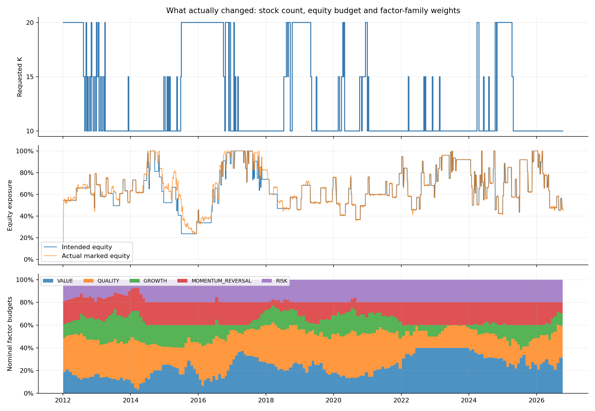
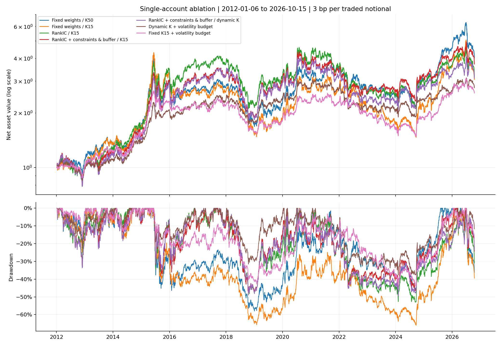
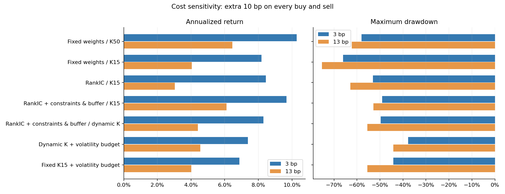
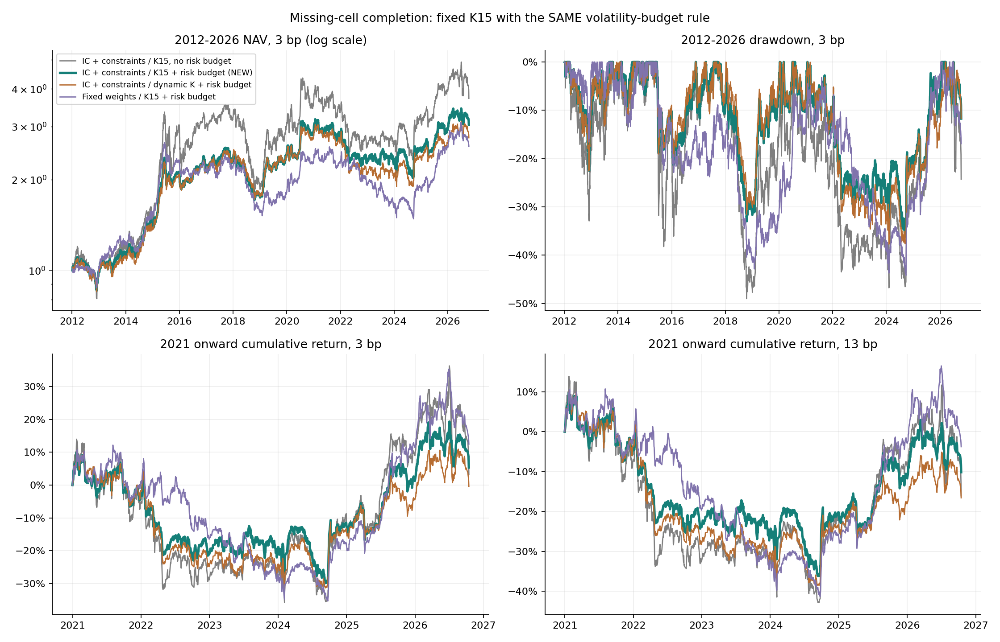

# 小组合的长期回测：RankIC加权、动态持仓与仓位管理的效果对比

研究日期：2026-10-20。状态：历史研究完成，未替换六策略纸面账户，未接入真实下单。

**2026-10-21补充：已完成“IC＋分散缓冲固定15只＋仓位管理”。前十节保留首轮七组结果，第十一节给出第八组补测、相同风控下的对照及更新结论。**

## 一、先说结果

这次把“像管理一只基金那样，持有十几只股票、动态使用因子、必要时减仓”的想法做成了可回放的代码。

结论不是功能越多越好，而是：

1. 固定15只加入本轮 RankIC 权重后，长期收益提升很小，换手明显增大；成本提高后收益反而低于固定权重15只。
2. 固定15只再加分散约束和持仓缓冲，回撤与换手有所改善。这一步同时加入了两种机制，不能把全部改善归因于行业限制。
3. 在同样机制上，把15只改成动态10–20只，没有进一步改善本轮结果。
4. 降低总股票仓位确实减小了波动和最大回撤，但也牺牲了收益；完整版本仍出现37.72%的最大回撤。
5. 2021年以后的表现明显弱于早期。完整版本这一段累计收益为-0.38%，年化约-0.07%，谈不上稳定赚钱。

所以，工程已经能做这件事，但实验没有证明“十几只股票＋自动调整”可以稳定抵抗下跌或板块轮动。组合管理解决的是如何持有风险，不会自动创造选股超额。

## 二、这次到底比较什么

所有版本用同一基础点时点股票池、同一批传统因子、同一交易日历、同一撮合和成本程序。

| 版本 | 与前一层相比改变什么 |
| --- | --- |
| 固定权重／50只 | 现有基础多因子固定配方的50只参考；不是把六账户收益混在一起 |
| 固定权重／15只 | 只把目标持仓从50只缩到15只 |
| RankIC权重／15只 | 月度更新因子权重，仍持有15只 |
| RankIC＋分散与缓冲／15只 | 再加行业／主题／相关性约束，以及持仓缓冲 |
| RankIC＋分散与缓冲／动态10–20只 | 其余规则不变，再按分散程度选择10、15或20只 |
| 动态10–20只＋仓位管理 | 再依据历史波动调整股票总仓位 |
| 固定权重15只＋仓位管理 | 额外对照：不使用IC和动态K，只给固定15只加同样的波动仓位规则 |

这里的“固定权重”不是13个因子一律各占1/13。它沿用工程配方：五类因子预算各20%，类内等权；每只入选股票的目标权重才是1/K。

没有增加消息、公告、机器学习因子，也没有把刚研究的 Beta 加入排序。Beta并不因为适合风险解释，就自动成为有效选股因子。

### 先分清三件事：选谁、选几只、投多少钱

这几个版本名称比较长，是因为把不同层次的规则写在了一起：

- **因子权重**决定怎样给股票打分，主要回答“选谁”。RankIC在这里用于调整因子的重要程度，不是直接决定每只股票买多少钱。
- **持仓数量K**决定目标选几只股票，例如15只，或者从10、15、20只中选择。
- **总股票仓位**决定账户中多少钱投进股票，剩余多少钱留现金。持有15只股票，既可以接近满仓，也可以只投入账户资金的60%。

下面用同一个例子解释：假设账户有30万元。所有金额都只是帮助理解的目标配置，暂不考虑手续费、整手限制和无法成交的情况，不是实盘买入建议。

### 1. RankIC＋分散与缓冲／15只：用IC打分，但不要集中押注，也不要频繁换股

这个版本始终以15只为目标，但不是简单地把综合分数前15名全部买入。

**RankIC**：参考已经实现的历史收益，按月调整因子权重，再用这些因子给当时股票池中的股票打分。具体的权重上限和更新规则见第四节。

**分散**：从高分候选股中挑选时，还要限制行业、共同主题和股价走势的相关性。比如15只股票等权、单行业上限20%，意味着同一行业最多选3只。即使某行业有6只股票排名很靠前，也不能把这6只全部装进组合。不同细行业也可能同属科技主题，或者涨跌高度同步，所以不能只数行业名称。

**缓冲**：给已有持仓留一点排名下降的空间，减少无谓买卖。例如一只已持有股票从第12名掉到第18名，仍在前30名，即前2K名内，就有优先保留的资格；不是一跌出前15名就必须卖掉。但它仍须满足股票池资格和分散约束，缓冲不等于无条件保留。

如果选满15只，目标接近满仓，每只约占总资金的1/15。30万元对应每只约2万元。它没有额外根据市场波动主动降低总仓位。

一句话：**还是选15只，但同时考虑分数、集中风险和换股成本。**

### 2. RankIC＋分散与缓冲／动态10–20只：保留上面的规则，再让数量随分散程度变化

这个版本保留RankIC、分散约束和持仓缓冲，新增的变化只有：持仓数量不再固定15只，而是在**10、15、20只三个档位**中选择，不是在10到20之间任意取数。

程序先尝试10只，利用此前的股价收益估计组合是否达到预先约定的分散标准；达到就使用10只。未达到，再尝试15只和20只。如果三个档位都达不到，按事先规则使用20只，但不能因此声称分散已经达标。具体指标见第五节。

它不是“过去哪种数量赚得多，就选哪种数量”，也不是“感觉行情不好就少买几只”。分散指标只是在评估这些股票一起持有时的风险结构。

以30万元为例，选满且不主动留现金时，10只对应每只约3万元，15只约2万元，20只约1.5万元。**股票变少，单只反而买得更多，总投入并没有随之降低。**

一句话：**选股方法不变，根据估计的分散程度决定装10只、15只还是20只；不是择时减仓。**

### 3. 动态10–20只＋仓位管理：既决定买几只，也决定股票一共买多少钱

这是第二个版本的完整延伸。名称为了简短省略了前半部分，**并没有取消RankIC、分散约束和持仓缓冲**。

它先按第二个版本确定股票名单和数量，再估计这篮子股票的历史波动，决定总资金中有多大比例用于股票。估计波动较高时，规则会提出较低的股票仓位；估计波动较低时，可以提出较高仓位，但不加杠杆。实际调整还受变化门槛和冷却期限制，见第六节。

例如，程序本周选了15只股票，同时给出60%的总股票仓位。30万元中，18万元用于股票、12万元留现金，每只股票目标约1.2万元，即总账户的4%，而不是每只仍买2万元。

如果下一次选10只、仓位仍为60%，则仍然只投入18万元，每只约1.8万元。这里就能看清：**持仓数量控制每只分多少，总仓位控制一共投多少。**

它每天检查风险，但不会因此每天重新选股；股票名单仍按周调整，额外的仓位交易也必须满足规则。减仓可能减轻下跌损失，也可能错过上涨，不能理解成自动预测涨跌。

一句话：**保留动态选股组合，再通过现金比例调整整体风险。**

### 4. 固定权重15只＋仓位管理：不改变因子配方，只测试减仓有没有帮助

这个版本不是在第三个版本上继续加功能，而是另开的一组较简单对照：

- 因子配方仍用原来的五类预算各20%、类内等权，不用RankIC动态调整因子权重。
- 每周按固定配方评分，目标持有前15只，数量不自动变化。
- 不加入本轮新增的行业／主题／相关性限制与持仓缓冲；原有基础股票池资格规则仍然保留，并非完全没有风险筛选。
- 单独加入与第三个版本相同的波动仓位管理规则。

例如，仍然由固定配方选出15只股票，但风控给出的股票仓位是60%，则30万元同样只投入18万元，每只约1.2万元。因子权重固定，不代表必须满仓，也不代表一直持有同一批股票。

它的作用是回答：**如果风险下降了，有多少改善可能只来自减少股票投入，而不必依赖RankIC或动态持仓数量？** 两个风控版本使用相同规则，但因为选中的股票不同，估计波动和具体仓位也可以不同。

读后面的结果时，请分开看这几个问题：第二个版本与第一个比较，检验动态数量是否有帮助；第三个与第二个比较，检验额外仓位管理的作用；第四个与“固定权重／15只”比较，检验简单组合加仓位管理的效果。不能只按名称中功能的多少判断谁更好。

## 三、数据和交易时点

- 价格历史从2010年开始，2011年用于积累成熟的 IC 和递推初始权重。
- 主评估从2012-01-06信号开始，首笔交易在下一交易日收盘；最终估值日为2026-10-15，共756次周度选股。
- 每周最后一个交易日收盘后计算选股；不能按刚看到的该日收盘价成交，统一下一交易日收盘执行。
- 因子权重每月第一个周度信号才更新，月内保持；风控每天检查，但不是每天换股。
- 这是同一历史区间上的事后研究，不是从未看过数据的独立留出集。所有版本从现金重新开始，不直接拼接之前回测的持仓。
- 收益年化采用252个交易日；夏普无风险利率取0；现金利息取0。2026年为不完整年度。

数据来自此前已完成的长历史因子缓存，本次不需要再下载，也不需要新的 Tushare token。缓存逐文件校验哈希，并核对固定配方每周前100名与原工程完全一致。

## 四、RankIC权重究竟怎么计算

RankIC衡量的是：当时因子排名靠前的股票，随后收益排名是否也更靠前。它不是股票涨跌概率，也不能直接判断下一次大盘会不会跌。

本轮沿用五交易日收益标签：信号后下一交易日收盘买入，再持有五个交易日的收益。更新权重时，只有标签结束日**严格早于更新日**的历史记录才能进入计算。尚未走完的五天不能拿来算 IC。

具体规则在运行前固定：

1. 读取最近252个已经成熟的日度 RankIC，每个因子至少120个有效观测。
2. 正平均 RankIC 才获得新的目标权重；负值不反向交易，也不分配新的正目标权重。
3. 按正值比例分配，单个因子名义权重上限20%。如果不足五个正值因子，无法在该上限下分满100%，便保留上一版权重。
4. 每次月度更新，单因子权重最多改变5个百分点；用整体插值实现，不对各因子独立截断后随意补差。
5. 初始采用原五类预算，随后可以变化；没有永久保留“50%固定等权”，也没有永久固定五类各20%。

因此准确名称是**带上限与变化速度约束的 RankIC 自适应权重**，不是此前完全不受约束的纯IC实验。仍沿用“类内合成—类别再标准化—按类别预算合成”的两层打分结构，不能把名义权重当成对原始财务值直接相乘的系数。

若个别股票在某个正权重类别内没有可用数据，只在实际可用类别间重分预算；原始固定配方不合格的股票不能因此进入。该处理涉及15,968个股票周，约占共同候选股票周的0.93%，已单独记录。

主评估期间共178次月度更新，其中9次因正值证据不足保留上一版。下表是月度更新时点的平均**名义**权重，不是组合实际风险贡献：

| 因子 | 月度更新时点平均名义权重 |
| --- | --- |
| VOLATILITY | 18.95% |
| REVERSAL_5D | 16.89% |
| PE | 15.73% |
| ROE | 9.37% |
| FREE_CASH_FLOW_YIELD | 8.01% |
| REVENUE_GROWTH | 7.79% |
| NET_MARGIN | 7.24% |
| PROFIT_GROWTH | 5.54% |
| GROSS_MARGIN | 4.22% |
| LOW_DEBT_TO_ASSETS | 3.21% |
| CASH_PROFIT_QUALITY | 3.05% |
| MOMENTUM | 0.00% |
| MOMENTUM_60D | 0.00% |

可以看到，这套五日标签下，中期动量两项在主评估期的权重为零。它只说明本轮规则没有给它们权重，不能推广成“动量永远无效”。收益期限与因子适用期限是否匹配，仍然是研究边界。

## 五、为什么程序有时持有10只，有时持有20只

先从同一综合分数的前100名中选股，再执行这些预设约束：

- 单行业目标占总资金不超过20%；科技综合主题不超过35%，主题包括电子、计算机、通信、传媒、电力设备。
- 两只股票最近126个交易日的正相关系数不超过0.8；每只至少100个有效观测、每对至少80个共同观测。未知相关性不当作零。
- 已实际持有且仍排在前2K名的股票优先保留，但仍须满足上述约束。不是排名从15掉到16就立刻卖掉。
- 行业缺失统一归入UNKNOWN并受同一上限限制，不把每个未知股票都假装成不同的行业。
- 如果选不满，空缺部分留现金，不给剩下股票加权绕过上限；本轮实际没有未选满周。

动态K依次尝试10、15、20只。用历史协方差估计“平均个股波动÷组合波动”的平方，达到3就选最小的K；三个都不达标时使用20，不挑过去收益最好的K。

这个量是一个分散程度指标，**不是确切的独立股票数量**。协方差使用20%对角收缩与非负特征值修正，以减轻估计不稳定；它仍然是估计，危机时相关性可以突然升高。

| 动态版本 | 10只周数 | 15只周数 | 20只周数 | 未选满周数 |
| --- | --- | --- | --- | --- |
| RankIC＋分散与缓冲／动态10–20只 | 526 | 55 | 175 | 0 |
| 动态10–20只＋仓位管理 | 527 | 56 | 173 | 0 |

两种动态版本的周数略有不同，因为风控交易可能改变下一次周度决策时的真实持仓，缓冲规则读取的是实际持仓，不是上次写下的目标名单。

## 六、仓位管理做了什么，没有做什么

对当前拟持有的一篮子股票，使用截至信号日可见的最近60个交易日收益，至少40个共同有效观测，估计年化波动。拟定股票仓位倍数为：

> 15%目标年化波动 ÷ 估计年化波动，限制在20%到100%之间；不加杠杆。

每天检查，但只有相对上次预算变化至少10个百分点、且距上次改变至少五个交易日，才额外交易。首次有有效估计时初始化不受该门槛限制；周度正常选股仍会交易。

缺乏足够共同历史时，保留上一预算并记录失败，**不是假设风险为零，也不是保证安全**。15%是目标，不是实现值上限；完整版本实际年化波动为16.27%。

| 版本 | 目标数量 | 执行后平均实际持股数 | 额外风控交易日 | 无法估计风险的检查日 |
| --- | --- | --- | --- | --- |
| 固定权重／50只 | 50 | 52.30 | 0 | 不适用 |
| 固定权重／15只 | 15 | 15.75 | 0 | 不适用 |
| RankIC权重／15只 | 15 | 15.58 | 0 | 不适用 |
| RankIC＋分散与缓冲／15只 | 15 | 15.51 | 0 | 不适用 |
| RankIC＋分散与缓冲／动态10–20只 | 10／15／20 | 13.15 | 0 | 不适用 |
| 动态10–20只＋仓位管理 | 10／15／20 | 13.07 | 66 | 167/3584 |
| 固定权重15只＋仓位管理 | 15 | 15.71 | 68 | 680/3584 |

完整版本在整个历史中额外增加66个风控交易日，并没有变成每天换股的高频系统。风险历史不够时保留预算是本版明确的局限，实盘前必须设计数据中断和陈旧估计的保守处置。

实际持股可能超过目标K，是因为部分旧持仓当日没有价格而无法卖出；也会有按旧价格记账的未报价资产。限额约束的是下达的目标，不保证缺价、停牌或价格漂移后的真实组合也恰好满足。

| 版本 | 历史最大实际持股数 | 单日最高未报价资产占净值 |
| --- | --- | --- |
| 固定权重／50只 | 86 | 64.76% |
| 固定权重／15只 | 26 | 60.12% |
| RankIC＋分散与缓冲／15只 | 29 | 82.08% |
| 动态10–20只＋仓位管理 | 32 | 38.28% |

这不是可以略过的小误差。完整动态风控版有时实际持有32只，单日未报价资产最高占净值38.28%。这里“未报价”只表示本价格面板当日缺价，不能未经交易状态核验就全部认定为停牌。回放不伪造成交，而是保留旧仓并按最后价格估值；这种估值不能代表当日能按该价格卖出。

本版风控估计的是**拟持有篮子**，没有把无法退出的额外旧仓逐一并入风险估计。这也是它仍属研究回放、不能直接认定为可实盘账户管理器的原因。真实上线需要把实际持仓、停复牌／涨跌停状态和风险估计失败处置一起纳入执行闭环。



图中第一行显示K的选择，第二行对比目标和实际股票仓位，第三行显示五类因子的名义预算。动态K与降低总仓位是两件不同的事：把15只改成10只并不等于减少市场风险。

## 七、完整结果：低成本口径

**正式评估区间为2012年1月6日至2026年10月15日，约14年9个月。** 2010—2011年的数据用于价格指标预热、积累历史IC及递推初始因子权重，不计入下面的累计收益。

以下每一笔买入和卖出均按成交额扣3bp，即0.03%。不是完整现实费用单，只是所有版本共用的研究口径。

表中的“累计收益”回答的是：**这接近15年里，初始本金一共增长了多少。** “年化收益”则将整段增长折算成复合年增长率；本文按252个交易日年化，不是把累计收益简单除以自然年数，也不表示每年都获得这个收益。

| 版本 | 累计收益 | 年化收益 | 年化波动 | 夏普 | 最大回撤 | 平均股票仓位 |
| --- | --- | --- | --- | --- | --- | --- |
| 固定权重／50只 | 302.54% | 10.29% | 24.79% | 0.52 | -58.02% | 99.96% |
| 固定权重／15只 | 206.20% | 8.19% | 26.41% | 0.43 | -66.00% | 99.92% |
| RankIC权重／15只 | 217.08% | 8.45% | 26.36% | 0.44 | -53.00% | 99.92% |
| RankIC＋分散与缓冲／15只 | 272.13% | 9.68% | 25.69% | 0.49 | -49.00% | 99.93% |
| RankIC＋分散与缓冲／动态10–20只 | 211.17% | 8.31% | 25.86% | 0.44 | -49.63% | 99.92% |
| 动态10–20只＋仓位管理 | 175.41% | 7.38% | 16.27% | 0.52 | -37.72% | 67.00% |
| 固定权重15只＋仓位管理 | 157.61% | 6.88% | 16.33% | 0.49 | -44.17% | 65.18% |

### 如果最初投入30万元，期末相当于多少钱

为了更直观地理解累计收益，下面把同一条回测净值等比例换算成30万元初始本金。假设收益持续复投，期间没有追加或取出资金：

| 版本 | 累计盈利金额 | 期末总资产（含30万元本金） |
| --- | --- | --- |
| 固定权重／50只 | 90.76万元 | 120.76万元 |
| 固定权重／15只 | 61.86万元 | 91.86万元 |
| RankIC权重／15只 | 65.12万元 | 95.12万元 |
| RankIC＋分散与缓冲／15只 | 81.64万元 | 111.64万元 |
| RankIC＋分散与缓冲／动态10–20只 | 63.35万元 | 93.35万元 |
| 动态10–20只＋仓位管理 | 52.62万元 | 82.62万元 |
| 固定权重15只＋仓位管理 | 47.28万元 | 77.28万元 |

换算公式是：**期末总资产＝初始本金×（1＋累计收益率）**。例如，完整动态风控版累计收益175.41%，表示本金增长了约1.7541倍，期末资产约为本金的2.7541倍，即30万元变成约82.62万元；不是期末只有52.62万元。

这些金额包含本节的研究交易成本，但只是比例资金回放的换算，**不是已经按30万元真实账户、整手买入和实际费用重新跑过的结果**。小资金能否按目标买齐股票，还需要单独验证。

更重要的是，**全期累计盈利不等于每个阶段都赚钱**：完整动态风控版虽然全期累计盈利175.41%，但2021年至本次回测终点这一段累计仍约亏0.38%，全期最大回撤达到37.72%。必须把总收益、阶段收益和中途亏损风险放在一起看。



净值图使用对数轴；下图为各自相对历史最高净值的回撤。重点不只是期末哪条线最高，而是亏损持续多久，以及加入新机制是否真的改善了路径。

几个可以分开的判断：

- 50缩到15：年化10.29%降至8.19%，最大回撤58.02%扩大到66.00%。小账户可执行性更好，并不意味着历史风险收益自然更好。
- 固定15到IC15：年化只增加约0.27个百分点，双边年换手从39.0倍升到51.2倍。IC并不是免费增强。
- IC15到固定15的分散＋缓冲：年化升至9.68%，最大回撤降至49.00%，换手降至33.0倍。这是一个值得保留的研究候选，但本轮没有拆开缓冲与约束各自的贡献。
- 固定15的分散＋缓冲到动态K：年化降至8.31%，最大回撤略恶化到49.63%。本轮没有证据支持为了“更智能”而强行使用动态K。
- 动态K再加仓位：波动25.86%降到16.27%，最大回撤49.63%降到37.72%，年化8.31%降到7.38%。这是风险与收益的交换，不是无代价消除下跌。

## 八、把交易成本提高以后

压力口径统一每笔买卖13bp，即0.13%，比主口径多10bp。每个账户都重新回放，持仓缓冲依然读取该账户的实际持仓。

| 版本 | 3bp年化收益 | 13bp年化收益 | 13bp最大回撤 | 年化双边换手 |
| --- | --- | --- | --- | --- |
| 固定权重／50只 | 10.29% | 6.46% | -62.21% | 35.3倍 |
| 固定权重／15只 | 8.19% | 4.05% | -75.27% | 39.0倍 |
| RankIC权重／15只 | 8.45% | 3.04% | -62.83% | 51.2倍 |
| RankIC＋分散与缓冲／15只 | 9.68% | 6.12% | -52.86% | 33.0倍 |
| RankIC＋分散与缓冲／动态10–20只 | 8.31% | 4.40% | -55.48% | 36.7倍 |
| 动态10–20只＋仓位管理 | 7.38% | 4.55% | -44.15% | 26.8倍 |
| 固定权重15只＋仓位管理 | 6.88% | 4.02% | -55.48% | 27.1倍 |

年化双边换手指全年“买入金额＋卖出金额”相对资金的累计倍数，不是全部股票每年整仓换手的次数。多10bp乘上较高换手，会积累成明显的收益损耗。



这一比较很关键：单独IC15的年化从8.45%降到3.04%，反而低于固定权重15只的4.05%。分散＋缓冲15只为6.12%；完整动态风控版本为4.55%，最大回撤仍有44.15%。

所以不能只展示低成本下更好看的收益。提高估计频率或交易频率之前，必须先证明新增信号覆盖得住交易成本。

## 九、长期赚钱，不等于每个时期都有效

| 版本 | 2012–2015年化 | 2016–2020年化 | 2021–2026年化 |
| --- | --- | --- | --- |
| 固定权重／50只 | 32.19% | 1.16% | 4.92% |
| 固定权重／15只 | 35.88% | -4.11% | 2.65% |
| RankIC权重／15只 | 37.96% | 2.47% | -3.51% |
| RankIC＋分散与缓冲／15只 | 33.12% | 3.90% | 0.57% |
| RankIC＋分散与缓冲／动态10–20只 | 31.92% | 3.32% | -1.53% |
| 动态10–20只＋仓位管理 | 20.91% | 6.14% | -0.07% |
| 固定权重15只＋仓位管理 | 24.21% | -0.06% | 2.14% |

上述分段均沿用同一持续账户，不在每段开头重新训练或重置仓位；这里只切片衡量阶段表现，分段回撤也从该段起点计。

大部分版本在2012–2015年获得了很高收益，之后明显变弱。最近一段，固定50只的年化为4.92%，固定15只为2.65%，IC15为-3.51%，完整动态风控约为-0.07%。

这说明当前瓶颈不能简单归结为“没有使用IC”或“持仓数量不会自动变化”。它更接近：**现有信号组合在较近市场中的扣费盈利能力不足，而且分散与减仓只能缓解风险，不能替代盈利来源。**

这不是证明所有因子都无效；也不能把本轮条件下的差异称为有统计显著性的永久优势。五日收益标签重叠，多个历史版本被反复比较，尚未建立独立前向证据。

## 十、验证做到了什么

- 新增7项规则测试，含标签成熟边界、未来数据扰动不影响过去输出、权重上限与变化速度、缺值、动态K、行业主题限制和风控冷却。
- 全仓库482项测试通过。
- 两个固定版本的完整每日净值，与另一套批量回放引擎逐日比对，最大绝对误差小于1.1×10⁻¹⁴。
- 756个评估周的固定配方前100名与原缓存完全一致；月度权重标签日期、现金、费用、下一交易日执行和目标限额独立复核通过。
- 六策略前向纸面账户的初始状态、计划和每日台账哈希前后一致，未受到本实验影响。

这些证明代码按照约定运行，不证明现实能够以同样价格成交。仍未纳入整手、最低佣金、真实印花税时间表、涨跌停排队、冲击成本和容量。复权价上的碎股比例资金回放，也不能回答“我的实际资金是否能买下这15只股票”。

此外沿用的数据仍有财务修订版本、历史行业覆盖不完整、现金流收益率近似字段等限制。不能把“数据跨度长”误写成“完全无偏的数据”。

## 十一、补齐固定15只的仓位管理对照（2026-10-21）

### 1. 这次补的不是新因子，而是原实验漏掉的一格

第一轮确实没有运行“IC＋分散缓冲固定15只＋仓位管理”，这个遗漏现在已经补齐。它与已有版本的区别很简单：

- 相对“IC＋分散缓冲固定15只”：只增加原来那套波动仓位管理。
- 相对“IC＋分散缓冲动态10–20只＋仓位管理”：只把目标数量固定为15只，不再按分散指标切换数量。
- 相对“固定因子权重15只＋仓位管理”：增加IC权重、分散限制和持仓缓冲。这一比较同时改变多项机制，不能把全部差异归功于IC。

新增版本每周仍然选15只，但不一定满仓；例如30万元账户、60%股票仓位时，目标为每只约1.2万元，另外12万元留现金。RankIC调整因子权重，分散规则限制集中风险，缓冲减少无谓换股，总仓位管理控制股票投入的总比例。

数据、IC历史窗口、因子权重上限、行业与主题限额、缓冲范围、波动目标、调整门槛及成本全部不变。仍为2012-01-06至2026-10-15，约14年9个月，不追加10月21日的数据，也不根据新结果调参。IC继续使用上限和变化速度约束，不是另换成无约束纯IC。

新旧风控版使用的是**同一套仓位规则**，不是强行使用同一条仓位曲线。股票篮子不同，估计波动和具体仓位自然可能不同；额外交易还可能改变后续缓冲所读取的实际持仓。

### 2. 低成本口径：固定15只加入仓位管理后的结果

每笔买卖按成交额扣3bp，即0.03%，结果如下：

| 版本 | 累计收益 | 年化收益 | 年化波动 | 夏普 | 最大回撤 | 平均股票仓位 |
| --- | --- | --- | --- | --- | --- | --- |
| IC＋分散缓冲固定15只（无仓位管理） | 272.13% | 9.68% | 25.69% | 0.489 | -49.00% | 99.93% |
| IC＋分散缓冲固定15只＋仓位管理（补测） | 204.17% | 8.14% | 16.15% | 0.565 | -36.15% | 67.79% |
| IC＋分散缓冲动态10–20只＋仓位管理 | 175.41% | 7.38% | 16.27% | 0.519 | -37.72% | 67.00% |
| 固定因子权重15只＋仓位管理 | 157.61% | 6.88% | 16.33% | 0.489 | -44.17% | 65.18% |

新版本累计收益为**204.17%**。若仅将回测净值等比例换算成30万元本金，期末约为**91.25万元**，其中盈利约61.25万元。不是只剩本金的204.17%，也不是一年赚204.17%；这仍不代表按30万元整手限制做过真实账户回测。

与相同选股规则、没有仓位管理的15只版本相比：

- 年化收益：9.68% → 8.14%。
- 年化波动：25.69% → 16.15%。
- 夏普：0.489 → 0.565。
- 最大回撤：-49.00% → -36.15%。

这说明减仓主要换来了更低的波动和回撤，而不是让绝对收益也同步上升。新版本平均股票仓位约67.79%，其余主要留现金。

与动态10–20只风控版相比，新版本年化收益高约0.75个百分点，最大回撤幅度小约1.57个百分点，夏普也略高。两者平均股票仓位分别为67.79%和67.00%，并不是固定15只靠明显更低的平均股票投入取得这一结果。

不过，这些历史差异并未经过独立样本显著性验证，不能写成“固定15只一定优于动态数量”。

### 3. 加大交易成本后，固定15只仍优于动态版本，但收益明显缩水

将每笔买卖成本提高到13bp，即0.13%，所有账户重新回放：

| 版本 | 13bp累计收益 | 13bp年化收益 | 13bp夏普 | 13bp最大回撤 |
| --- | --- | --- | --- | --- |
| IC＋分散缓冲固定15只（无仓位管理） | 132.66% | 6.12% | 0.361 | -52.86% |
| IC＋分散缓冲固定15只＋仓位管理（补测） | 115.33% | 5.54% | 0.415 | -41.89% |
| IC＋分散缓冲动态10–20只＋仓位管理 | 88.21% | 4.55% | 0.355 | -44.15% |
| 固定因子权重15只＋仓位管理 | 75.16% | 4.02% | 0.323 | -55.48% |

新增版本的年化收益从8.14%降至5.54%，最大回撤从-36.15%扩大至-41.89%。它仍优于动态风控版，但不能忽略超过四成的历史回撤。

| 版本 | 年化双边换手 | 额外风控交易日 | 平均实际持股数 |
| --- | --- | --- | --- |
| IC＋分散缓冲固定15只（无仓位管理） | 33.02倍 | 0 | 15.51 |
| IC＋分散缓冲固定15只＋仓位管理（补测） | 24.30倍 | 74 | 15.49 |
| IC＋分散缓冲动态10–20只＋仓位管理 | 26.76倍 | 66 | 13.07 |
| 固定因子权重15只＋仓位管理 | 27.13倍 | 68 | 15.71 |

“交易日更多”不等于“总交易金额更多”。新版本增加了部分减仓和回补操作，但由于平均股票投入更低，年化双边换手低于不做仓位管理的版本。双边换手按买卖金额相对账户净值累计，不能只看成交笔数或调仓次数判断成本。

### 4. 近年表现依然是主要短板

| 版本 | 2012–2015年化 | 2016–2020年化 | 2021–2026年化 |
| --- | --- | --- | --- |
| IC＋分散缓冲固定15只（无仓位管理） | 33.12% | 3.90% | 0.57% |
| IC＋分散缓冲固定15只＋仓位管理（补测） | 21.50% | 6.69% | 0.94% |
| IC＋分散缓冲动态10–20只＋仓位管理 | 20.91% | 6.14% | -0.07% |
| 固定因子权重15只＋仓位管理 | 24.21% | -0.06% | 2.14% |

分段沿用持续账户，只切片观察，没有在每段开头重置持仓。重点看2021年至2026-10-15这一段累计收益：

| 版本 | 近段3bp累计收益 | 近段13bp累计收益 |
| --- | --- | --- |
| IC＋分散缓冲固定15只（无仓位管理） | 3.21% | -16.08% |
| IC＋分散缓冲固定15只＋仓位管理（补测） | 5.34% | -10.16% |
| IC＋分散缓冲动态10–20只＋仓位管理 | -0.38% | -16.59% |
| 固定因子权重15只＋仓位管理 | 12.46% | -3.77% |

新版本在低成本口径下，这近六年累计只赚5.34%，年化约0.94%；高成本口径下累计亏10.16%，年化约-1.91%。而简单的“固定因子权重15只＋仓位管理”，同段低成本累计收益为12.46%，高成本累计亏3.77%，两种口径都好于新版本。

因此，**补测改善了这组长期风险收益对比，但没有解决近年盈利薄弱、对交易成本敏感的问题。** 全期领先不能代替分阶段检查，更不能直接升级为实盘默认策略。



图中绿色粗线是本次补测版本。左上看全期净值，右上看回撤；下方分别用3bp和13bp展示2021年以来的累计收益。下方曲线以2020年最后一个交易日净值为基点，用来保留2021年第一个交易日的收益。长期绿色线略好，并不意味着近几年也形成了足够强的盈利能力。

### 5. 这次如何保证是补齐对照，而不是另换一套实验

- 月度因子权重、每周股票排名和固定配方核对记录，与上一轮逐表一致。
- 三个已有对照在两档成本下全部重跑，共六组复现；每日净值最大绝对误差为4.44e-16，目标持仓、执行记录和逐笔交易也核对通过。
- 新增版本756个周度信号均固定目标15只，未选满周数为0；额外风控交易日为74。
- 本次新增4项接线测试，核实固定15只、真实持仓缓冲、仓位调整和未来数据不影响过去目标；全仓库486项测试通过。
- 独立复核费用、现金、下一交易日执行、权重与相关性约束通过，原始结果文件和六策略纸面账户没有改变。

这仍不等于实盘验收。新增版本实际持股最高达到29只，原因是旧持仓缺价时不能伪造卖出；单日未报价资产最高占净值36.23%。在3584个风险检查日中，178日共同历史不足而保留上一预算。风控估计的仍是拟持有篮子，没有把无法退出的额外旧仓逐一并入。这些限制没有在补测时被暗中修掉，因此对照保持一致，但生产可用性仍有限。

### 6. 补测后的结论

现在可以把结论说完整：**在本轮同数据、同成本、同风控规则的历史对照中，固定15只比动态10–20只略好；暂没有必要为了“更智能”而增加动态K这一层。** 不加仓位管理和加仓位管理的两种条件，都没有看到动态数量带来的优势。

但应保留两条边界。第一，新版本全期收益仍低于没有仓位管理的固定15只，风险改善有代价。第二，近年低收益、高成本下亏损以及36.15%的低成本最大回撤，说明它尚未解决稳定盈利问题。

因此，这次补测支持把“固定数量＋明确约束＋独立仓位管理”保留为更简单的研究候选，不支持宣称它已经能稳定抵抗下跌。它没有自动替换六策略日报，也没有获得实盘批准。下一步若推进实际账户，仍应先明确真实本金、可承受亏损，补足整手、真实费用与可成交性检查，再用新数据前向验证；不能继续用同一段历史反复挑赢家。

## 十二、复现与文件

协议：`research_protocols/20261020_single_account_adaptive_v1.json`

规则实现：`analysis/single_account_adaptive.py`

结果目录：`output/single_account_adaptive_20261020/`

主要表格：`performance.csv`、`subperiods.csv`、`annual.csv`、`factor_weights.csv`、`audit_summary.csv`。每个版本子目录保存每日净值、交易记录、目标持仓、风险决策和K候选试算；不是只有最终收益数字。

```bash
OPENBLAS_NUM_THREADS=1 OMP_NUM_THREADS=1 MPLCONFIGDIR=/private/tmp/quant-mpl .venv/bin/python scripts/run_single_account_adaptive.py
OPENBLAS_NUM_THREADS=1 MPLCONFIGDIR=/private/tmp/quant-mpl .venv/bin/python scripts/validate_single_account_adaptive.py
OPENBLAS_NUM_THREADS=1 MPLCONFIGDIR=/private/tmp/quant-mpl .venv/bin/python scripts/report_single_account_adaptive.py
.venv/bin/python -m unittest tests.test_single_account_adaptive -v
```

协议、输入或核心运行代码变化后，旧冻结目录会拒绝复用；请使用新的输出目录并标记新实验，不覆盖已有结论。

### 固定15只仓位管理补测的复现

补充协议：`research_protocols/20261021_fixed15_risk_extension_v1.json`

独立结果目录：`output/single_account_fixed15_risk_20261021/`。包含新组与三组重跑对照的绩效、分段收益、每日账本、目标、逐笔交易及`control_parity.csv`复现核对表；原10月20日结果不覆盖。

```bash
OPENBLAS_NUM_THREADS=1 OMP_NUM_THREADS=1 MPLCONFIGDIR=/private/tmp/quant-mpl .venv/bin/python scripts/run_fixed15_risk_extension.py
OPENBLAS_NUM_THREADS=1 MPLCONFIGDIR=/private/tmp/quant-mpl .venv/bin/python scripts/report_single_account_adaptive.py
.venv/bin/python -m unittest tests.test_fixed15_risk_extension -v
```

生成原报告时会自动读取已通过核验的补测结果，保留本节内容，不再恢复“该组合尚未测试”的旧结论。
